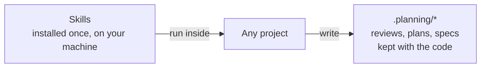
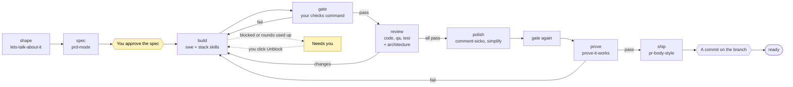
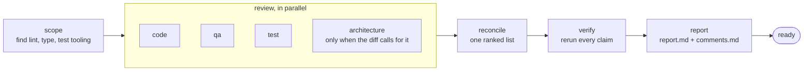

# Agent Skills

Personal library of agent skills: small, one-job instruction sets. Each skill = dir with `SKILL.md`. [AGENTS.md](AGENTS.md) = canonical index.

Use one alone (`qa-review` on a diff) or let the [factory](#how-the-factory-works) chain many: idea to reviewed local commit.

## Contents

- [The idea](#the-idea)
- [Philosophy](#philosophy)
- [Quick Start](#quick-start)
- [How the factory works](#how-the-factory-works)
- [How factory reviews a branch](#how-factory-reviews-a-branch)
- [Skills](#skills)
  - [How skills get used](#how-skills-get-used)
  - [Which skill do I use?](#which-skill-do-i-use)
  - [Understand](#understand), [Plan](#plan), [Build](#build), [Review](#review), [Verify and ship](#verify-and-ship), [Write and communicate](#write-and-communicate)
- [Architecture](#architecture)
- [Artifact Convention](#artifact-convention)
- [Contributing a Skill](#contributing-a-skill)
- [Local Setup](#local-setup)
- [Notes](#notes)

## The idea

1. **Skill does one thing.** `swe` smallest change. `qa-review` maintainability. `prove-it-works` real result. No skill is a workflow.
2. **Workflow = chain of skills.** `factory` calls skills as stages (build and review). Adds order, evidence checks, a place for your yes. No new judgment.
3. **You stay in control.** Agents write files, may plain commit and push. Script checks files before job moves on. Only your board click approves a spec. Destructive git and PR/MR creation denied.



Skills travel with you. Output stays with the project.

## Philosophy

- **Skills travel with the developer.** Live in `~/.agents`: update once, updated everywhere. No per-project installs, no drift.
- **Artifacts stay in the project.** Reviews, plans, specs describe one codebase. They go in `.planning/*`, same commit as the code.
- **Big workflows split into small skills.** Easier to read, test, reuse. Parent orchestrator chains them.
- **Workspace agnostic.** Same skills in any directory. Output is project-aware, machinery is not.

## Quick Start

```bash
npx skills add ChristopherAlphonse/calphonse-skills --list            # list
npx skills add ChristopherAlphonse/calphonse-skills --all             # all
npx skills add ChristopherAlphonse/calphonse-skills --skill <name>    # one
```

### Updating installed skills

```bash
npx skills update          # interactive
npx skills update -g       # global only
npx skills update -p       # project only
npx skills update <name>   # one skill
npx skills update -y       # no prompts
```

### Your first five minutes

Start with `whats-going-on`. Reads repo, writes findings, never edits code.

1. `npx skills add ChristopherAlphonse/calphonse-skills --skill whats-going-on`
2. In any project say: `use whats-going-on on this repo` (or `/whats-going-on`).
3. Open `.planning/system/`: `architecture.md`, `onboard.md`, `simplify-onboarding.md` (plain language).

Then `qa-review` on a branch with changes. Reviews only changed lines, ends approve or block.

## How the factory works

`factory` takes a feature idea, makes a reviewed commit on a local branch plus PR body. Plain pushes allowed. Never opens PR or MR.

Each box = stage. Fresh agent runs the named skill, writes one file. Script `bin/job` reads it, decides if job moves on. Gold boxes wait for your click.



Safe unattended:

| Rule                  | Meaning                                                                                                                              |
| --------------------- | ------------------------------------------------------------------------------------------------------------------------------------ |
| Evidence, not "done"  | Agent saying done = nothing. `bin/job` advances only when stage file exists with right status line and gate passes on real output.  |
| Fresh agent per stage | No memory carried over, so reviewer never inherits builder's blind spots.                                                            |
| Bounded retries       | `max_rounds` build rounds (default 3), then **Needs you**. No loop.                                                                  |
| No force push, no PR  | Plain commit and push OK. Shell rules block force push, hook bypass, `gh`, `glab`, `curl`. Protected remote branches = real backstop. |

Stack skills picked from file names, not by agent: TS/React add `typescript-strict-style` and `vercel-react-best-practices`, C# adds `dotnet`, Python adds `python`.

State machine, trust model, setup (Claude Code, Kiro, OpenCode): [factory/README.md](factory/README.md). Agent contract: [factory/SKILL.md](factory/SKILL.md).

## How factory reviews a branch

Review job reviews an existing branch or diff (`JOB create <id> "<title>" --review BASE HEAD`). Read-only: no edits, commits, or comments.



Verify is the point. Reviewers can be wrong. Verifier did not write reviews: opens every cited line, reruns every command in scratch copy, marks each finding confirmed, dropped, or unverifiable. Only confirmed reach the report, with paste-ready MR comments.

Details: [factory/README.md](factory/README.md). Review jobs show on the board's Review tab.

## Skills

### How skills get used

Skill = Markdown file agent reads when task matches. Name it in prompt, type `/qa-review`, or describe the task and let agent match `description`.

- `simplify` = shared writing check. `swe`, `pr-body-style`, `documentation-writer`, `performance-review-humanizer`, `factory` point at it.
- `code-review-frontend` falls back to `whats-going-on` when no codebase map.
- `factory` calls most others as stages.

### Routing in code

`scripts/route "<task>"` picks skills without a model. Reads prompt, changed files (git or `--files`), git state; prints `name`, `path`, `reason` per skill. Plain Python, no deps, same in any shell or agent CLI.

- Rules: `scripts/route-rules.json`. File-type table = `STACK_RULES` in `factory/bin/job`, which `route` reads (one copy).
- Claude Code (`.claude/settings.json`) and Kiro run it every prompt via `scripts/route-hook`. Kiro: add `{"command": "REPO/scripts/route-hook"}` under `userPromptSubmit`. Not tested on real Kiro CLI yet.
- CLIs without prompt hook (OpenCode, Codex, Gemini): follow [AGENTS.md](AGENTS.md), run `scripts/route` first.
- `scripts/route --check` fails if a rule names missing skill or `AGENTS.md` skill has no rule. `.githooks/post-merge` runs it. Tests: `python -m unittest discover -s scripts/tests`.

### Which skill do I use?

| I want to                                                  | Use                                                                                                                                                                                                                                                 | Try saying                                          |
| ---------------------------------------------------------- | --------------------------------------------------------------------------------------------------------------------------------------------------------------------------------------------------------------------------------------------------- | --------------------------------------------------- |
| Understand a repo I just joined                            | [whats-going-on](whats-going-on/SKILL.md)                                                                                                                                                                                                           | "What's going on in this repo?"                     |
| Find out if the architecture is over-built or too costly   | [architecture-review](architecture-review/SKILL.md)                                                                                                                                                                                                 | "Review the architecture and where we can cut cost" |
| Stress-test a plan before building it                      | [lets-talk-about-it](lets-talk-about-it/SKILL.md)                                                                                                                                                                                                   | "Let's talk about it: I want to add X"              |
| Write a PRD, or turn one into tasks                        | [prd-mode](prd-mode/SKILL.md)                                                                                                                                                                                                                       | "Help me write a PRD for X"                         |
| Learn whether something is feasible                        | [spike](spike/SKILL.md)                                                                                                                                                                                                                             | "Spike this: can we do X?"                          |
| Make a change with the least code                          | [swe](swe/SKILL.md)                                                                                                                                                                                                                                 | "Fix this, smallest change that works"              |
| Build a whole feature with checkpoints                     | [factory](factory/SKILL.md)                                                                                                                                                                                                                         | "/factory add X"                                    |
| Review my own change for maintainability                   | [qa-review](qa-review/SKILL.md)                                                                                                                                                                                                                     | "QA review my changes"                              |
| Check that my tests would catch a bug                      | [test-review](test-review/SKILL.md)                                                                                                                                                                                                                 | "Are these tests good enough?"                      |
| Review a React or TypeScript PR                            | [code-review-frontend](code-review-frontend/SKILL.md)                                                                                                                                                                                               | "Review this PR"                                    |
| Review a branch end to end, get paste-ready comments       | [factory](factory/SKILL.md)                                                                                                                                                                                                                         | "/factory review main my-branch"                    |
| Merge several reviews into one fix list                    | [reconcile-reviews](reconcile-reviews/SKILL.md)                                                                                                                                                                                                     | "Reconcile these reviews"                           |
| Confirm work is really done                                | [prove-it-works](prove-it-works/SKILL.md)                                                                                                                                                                                                           | "Prove it works"                                    |
| Strip noisy comments from a diff                           | [comment-sicko](comment-sicko/SKILL.md)                                                                                                                                                                                                             | "Run comment-sicko on this branch"                  |
| Write a short, accurate PR description                     | [pr-body-style](pr-body-style/SKILL.md)                                                                                                                                                                                                             | "Write the PR body"                                 |
| Explain a change out loud to stakeholders                  | [demo-script](demo-script/SKILL.md)                                                                                                                                                                                                                 | "Write a demo script for this"                      |
| Write or fix documentation                                 | [documentation-writer](documentation-writer/SKILL.md)                                                                                                                                                                                               | "Write a how-to for X"                              |
| Get a plain-language version of a reply                    | [simplify](simplify/SKILL.md)                                                                                                                                                                                                                       | "ELI5"                                              |
| Turn a self-review into warmer first-person prose          | [performance-review-humanizer](performance-review-humanizer/SKILL.md)                                                                                                                                                                               | "Humanize my performance review"                    |
| Run untrusted code or an agent in isolation                | [docker-app-sandboxing](docker-app-sandboxing/SKILL.md)                                                                                                                                                                                             | "Sandbox this repo and run it"                      |
| Work with AWS, .NET, React, TypeScript, or a Next.js proxy | [aws](aws/SKILL.md), [dotnet](dotnet/SKILL.md), [vercel-react-best-practices](vercel-react-best-practices/SKILL.md), [typescript-strict-style](typescript-strict-style/SKILL.md), [nextjs-proxy-csp-hardening](nextjs-proxy-csp-hardening/SKILL.md) | Name the stack in your task                         |

### Understand

| Skill                                               | What it does                                                                                                                                  | Use it when                                         |
| --------------------------------------------------- | --------------------------------------------------------------------------------------------------------------------------------------------- | --------------------------------------------------- |
| [whats-going-on](whats-going-on/SKILL.md)           | Reads unfamiliar repo, writes map: architecture, 3-5 traced flows, stack, conventions, concerns, use cases, plain copy. To `.planning/system/`. Never edits source. | Joined a project or about to refactor one you don't know. |
| [architecture-review](architecture-review/SKILL.md) | Audits for needless complexity, bottlenecks, reliability risks, infra cost. Simplest fix. Findings marked `VERIFIED`, `[ASSUMPTION]`, `[NEEDS MEASUREMENT]`. Read-only. | Is system over-built? What breaks at 10x traffic?   |

### Plan

| Skill                                             | What it does                                                                                                                                                                       | Use it when                                          |
| ------------------------------------------------- | ---------------------------------------------------------------------------------------------------------------------------------------------------------------------------------- | ---------------------------------------------------- |
| [lets-talk-about-it](lets-talk-about-it/SKILL.md) | Checks plan against local code and docs, one question at a time, states assumptions, recommends simplest path, lists how to verify. Big feature ends with copy-ready build prompt. No implementing. | Plan, design, or term feels fuzzy.                   |
| [prd-mode](prd-mode/SKILL.md)                     | Writes PRD from the problem, sets metrics, bounds scope. Can turn finished PRD into task list in `.planning/tasks/`.                                                               | Idea needs engineering and design agreeing on why.   |
| [spike](spike/SKILL.md)                           | Splits idea into 2-5 feasibility questions in story points, one throwaway experiment each. Verdict `VALIDATED`/`PARTIAL`/`INVALIDATED`/`INCONCLUSIVE` with pasted output. In `spikes/`. AWS spikes use Floci in Docker, never real AWS. | "Is this even possible?" Deliverable is the answer.  |

### Build

| Skill                                                               | What it does                                                                                                                              | Use it when                                          |
| ------------------------------------------------------------------- | ----------------------------------------------------------------------------------------------------------------------------------------- | ---------------------------------------------------- |
| [swe](swe/SKILL.md)                                                 | Whole task, least new code: reuse, no unrequested options, finish every caller and test touched. Ends with what it skipped and risk.     | Any change wanting small, complete diff.             |
| [typescript-strict-style](typescript-strict-style/SKILL.md)         | Strict TS/JS: bounded loops, asserted preconditions, explicit errors, small functions, no unchecked casts, few deps. Cites rule on flag. | Writing or reviewing TS/JS.                          |
| [vercel-react-best-practices](vercel-react-best-practices/SKILL.md) | Vercel Engineering React/Next.js perf rules, plus components, hooks, state, forms, a11y.                                                  | Writing, reviewing, refactoring React/Next.js.       |
| [nextjs-proxy-csp-hardening](nextjs-proxy-csp-hardening/SKILL.md)   | Secure `proxy.ts`: CSP, nonces, security headers, `middleware.ts` migration. CSP bypass reference for authorized testing.                 | Adding or auditing CSP in Next.js App Router.        |
| [docker-app-sandboxing](docker-app-sandboxing/SKILL.md)             | Runs app work and agents in Docker Sandbox (`sbx`): least-privilege mounts, private clones, network policy, credential proxy, reviewed retrieval. | Running unfamiliar code or autonomous agent on a repo. |
| [dotnet](dotnet/SKILL.md)                                           | Router. Picks guide for ASP.NET Core Web API (endpoints, DTOs, error middleware, OpenAPI) or design pattern review (Command, Factory, Repository, DI, SOLID). | C# or .NET work.                                     |
| [aws](aws/SKILL.md)                                                 | Router. Picks one of 24 guides (IAM, CDK, CloudFormation, networking, databases, serverless, Bedrock, billing...), loads only it.         | AWS service, credentials, or infra code.             |
| [python](python/SKILL.md)                                           | Router. Picks one of 16 guides (asyncio, pytest, typing, packaging, uv, observability, performance...), loads only it.                    | Writing or reviewing Python.                         |

### Review

Review skills report. They do not edit code.

| Skill                                                 | What it does                                                                                                                                          | Use it when                                        |
| ----------------------------------------------------- | ----------------------------------------------------------------------------------------------------------------------------------------------------- | -------------------------------------------------- |
| [qa-review](qa-review/SKILL.md)                       | Strict maintainability review of your changed lines only: abstraction problems, oversized files, growing condition chains. Ends approve or block.     | Hard look at own diff before review.               |
| [test-review](test-review/SKILL.md)                   | Would tests notice if diff were wrong? Five checks in order (scope, regression, behavior, concurrency, mutation) in throwaway worktree. To `.planning/reviews/test-review/`. | Want proof tests are good, not a count.            |
| [code-review-frontend](code-review-frontend/SKILL.md) | Finds repo lint/type/test tooling, runs parallel specialists: base checklist, TS and React, frontend patterns, Vercel perf. Findings `VERIFIED` or `[ASSUMPTION]`. | Reviewing a frontend PR.                           |
| [reconcile-reviews](reconcile-reviews/SKILL.md)       | Compares reviews of one PR, checks claims against code, ranks by evidence, pins fix to `path:line`. Posts inline MR comments on request.              | Reviewers disagree, need one list.                 |
| [factory](factory/SKILL.md)                           | Runs review skills as pipeline, verifies every finding. See [How factory reviews a branch](#how-factory-reviews-a-branch).                            | Whole branch reviewed and reported.                |

### Verify and ship

| Skill                                     | What it does                                                                                                                                      | Use it when                                         |
| ----------------------------------------- | ------------------------------------------------------------------------------------------------------------------------------------------------- | --------------------------------------------------- |
| [prove-it-works](prove-it-works/SKILL.md) | Checks real result (run feature, read real value, look at real changes), not "it compiles" or agent report. Ends with UAT doc a non-developer can follow. | Task done, about to say so.                         |
| [comment-sicko](comment-sicko/SKILL.md)   | Hunts narration, banners, commented-out code, long justifications in a diff. Workaround code needing real fix = `MUST KILL`. Reports; edits comments only on request. | Want branch free of comment clutter.                |
| [pr-body-style](pr-body-style/SKILL.md)   | Short, business-focused PR body matching real diff and check status. Keeps repo template headings.                                                | Writing, rewriting, auditing a PR description.      |
| [factory](factory/SKILL.md)               | Chains skills above, idea to reviewed local commit. See [How the factory works](#how-the-factory-works).                                          | Whole feature end to end, you approve at two points. |

### Write and communicate

| Skill                                                                 | What it does                                                                                                         | Use it when                                  |
| --------------------------------------------------------------------- | -------------------------------------------------------------------------------------------------------------------- | -------------------------------------------- |
| [documentation-writer](documentation-writer/SKILL.md)                 | Docs in one Diátaxis mode (tutorial, how-to, reference, explanation), never mixed. Product copy principles.          | Writing or restructuring docs.               |
| [demo-script](demo-script/SKILL.md)                                   | Short spoken script: previously, now, demo, result, business impact. Never invents metrics.                          | Presenting a change to outcome-minded people. |
| [simplify](simplify/SKILL.md)                                         | Restates last message in plain language: outcome first, then the one reason that matters.                            | You say "I don't follow" or "ELI5".          |
| [performance-review-humanizer](performance-review-humanizer/SKILL.md) | Rewrites first-person self-review warmer. Keeps every fact and number. Can borrow a sample's style, not its words.   | Self-review draft reads stiff.               |

## Architecture

```text
AGENTS.md          Canonical index of all skills
README.md          This file
{skill-name}/
  SKILL.md         Skill instructions and workflow
  references/      Optional deep-dive docs loaded on demand
```

No lockfile. Git tracks versions.

## Artifact Convention

Output goes in `.planning/*` in the target project, not `docs/`, home dirs, or cache.

- `.planning/reviews/`: review outputs, readiness summaries
- `.planning/qa/`: QA plans, reports, results
- `.planning/tasks/TODOS.md`: follow-ups, deferred tasks
- `.planning/strategy/`: product/strategy notes
- `.planning/plans/`, `.planning/requirements/`, `.planning/specs/`: plan inputs

## Contributing a Skill

1. Create `{skill-name}/SKILL.md`: front-matter `name:` matches folder, `description:` says _when_ to use it.
2. Add row to [AGENTS.md](AGENTS.md) index, alphabetical.
3. Add to matching category here.
4. Output paths under `.planning/*`.
5. Commit or verify any `references/*.md` or `@`-prefixed external workflow file. Missing reference silently disables the workflow.
6. Remove references to tools, folders, sibling skills that don't exist.
7. Reference existing skills, don't copy big blocks.

## Local Setup

Edit a skill and apply globally without reinstall: symlink repo into the skill store OpenCode reads:

```bash
REPO=~/calphonse-skills
mkdir -p ~/.config/opencode/skills

for d in "$REPO"/*/; do
  [ -f "$d/SKILL.md" ] || continue
  ln -sfn "${d%/}" ~/.config/opencode/skills/"$(basename "$d")"
done
```

`~/.config/opencode/skills` = path OpenCode reads (`skills.paths` in `opencode.json`). `SKILL.md` edits apply immediately. No reinstall, no copy.

To make `swe` active from first message in Claude Code, Kiro, OpenCode: run `git config core.hooksPath .githooks` once. Then `scripts/install-swe-hook` runs on every pull and every Claude Code session here. Same path enables `.githooks/commit-msg`, which rejects `Co-Authored-By`. See [swe/references/always-on.md](swe/references/always-on.md).

Leave `~/.agents/skills` alone: Skills CLI and its lockfile own it.

## Notes

Skills from mixed sources. Some original, some adapted from other repos with small changes.
