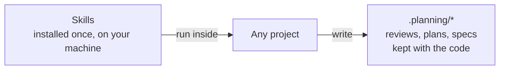
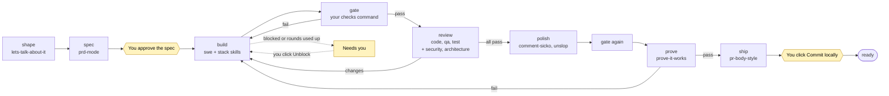
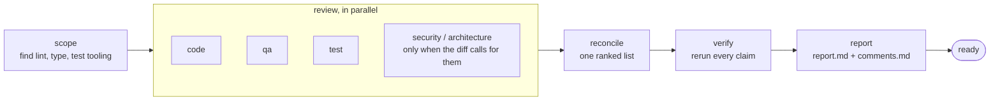

# Agent Skills

A personal library of agent skills: small, single-purpose instruction sets that make an AI coding agent work the way you want. Each skill is a directory with a `SKILL.md` file. [AGENTS.md](AGENTS.md) is the canonical index.

Use one skill on its own, such as `qa-review` on a diff. Or let the [factory](#how-the-factory-works) chain many of them to take a feature from idea to a reviewed local commit.

## Contents

- [The idea](#the-idea)
- [Philosophy](#philosophy)
- [Quick Start](#quick-start)
- [How the factory works](#how-the-factory-works)
- [How factory-review works](#how-factory-review-works)
- [Skills](#skills)
- [Architecture](#architecture)
- [Artifact Convention](#artifact-convention)
- [Contributing a Skill](#contributing-a-skill)
- [Local Setup](#local-setup)
- [Notes](#notes)

## The idea

Three rules hold the whole repo together.

1. **A skill does one thing.** `swe` makes the smallest change. `qa-review` judges maintainability. `prove-it-works` checks the real result. None of them tries to be a workflow.
2. **A workflow is a chain of skills.** `factory` and `factory-review` call other skills as stages. They add no new judgment of their own. They add order, evidence checks, and a place for you to say yes.
3. **You stay in control.** Agents write files and leave code uncommitted. A script checks the files before a job moves on. Only your click on the board approves a spec or commits.



The skills travel with you. The output stays with the project it describes.

## Philosophy

Agent skills are personal. They encode your workflows, your review standards, your testing rituals. They should not live inside a single project.

**Skills travel with the developer.** When a skill lives in `~/.agents`, updating it once updates it everywhere. No per-project installs, no drift between copies. The same review standard applies to your weekend project and your team's monolith.

**Artifacts stay in the project.** Skills are portable. Their output is not. Reviews, plans, and specs describe a specific codebase, so they belong in `.planning/*` inside that project, at the same commit as the code they reference.

**Complex workflows decompose into small skills.** A large workflow is hard to read, test, and reuse. Splitting it into focused sub-skills solves all three. Each sub-skill does one thing; a parent orchestrator chains them together.

**The system must be workspace agnostic.** The same skills work in any project directory. The index and skill conventions assume nothing about the target project. They produce artifacts that are project-aware, but the machinery stays independent.

## Quick Start

Install any skill with the Skills CLI:

```bash
# List available skills
npx skills add ChristopherAlphonse/calphonse-skills --list

# Install all skills
npx skills add ChristopherAlphonse/calphonse-skills --all

# Install a single skill
npx skills add ChristopherAlphonse/calphonse-skills --skill <name>
```

### Updating installed skills

```bash
npx skills update          # interactive
npx skills update -g       # global skills only
npx skills update -p       # project skills only
npx skills update <name>   # one specific skill
npx skills update -y       # no prompts
```

## How the factory works

`factory` takes a feature idea and produces a reviewed commit on a local branch, with a PR body written. It never pushes and never opens a PR or MR.

Each box below is a stage. A fresh agent runs the skill named in it and writes one file. A script, `bin/job`, reads that file and decides whether the job may move on. Gold boxes wait for your click on the board.



Four things make this safe to run unattended:

| Rule | What it means |
| --- | --- |
| Evidence, not "done" | An agent saying it finished counts for nothing. `bin/job` advances a job only when the stage's file exists with the right status line, and the gate passes on a command's real output. |
| Fresh agent per stage | Each stage starts with no memory of the last one, so a reviewer never inherits the builder's blind spots. |
| Bounded retries | A job gets `max_rounds` build rounds (default 3), then lands in **Needs you** instead of looping. |
| No push, no PR | The only commit is the one you trigger. Shell rules block `git push`, `gh`, `glab`, and `curl`, and your remote's protected branches are the real backstop. |

Stack skills are picked from file names, not by the agent: TypeScript and React files add `typescript-strict-style` and `vercel-react-best-practices`, C# adds `dotnet`.

For the full state machine, the trust model, and setup for Claude Code, Kiro, and OpenCode, read [factory/README.md](factory/README.md). [factory/SKILL.md](factory/SKILL.md) is the contract an agent follows.

## How factory-review works

`factory-review` reviews a branch or diff you already have. It is read-only: it never edits the code, commits, or posts comments.



The verify stage is the point of the design. Reviewers make claims, and a claim can be wrong. The verifier did not write the reviews. It opens every cited line, reruns every command in a scratch copy, and marks each finding confirmed, dropped, or unverifiable. Only confirmed findings reach the report, with paste-ready comments for the MR.

See [factory-review/README.md](factory-review/README.md) for the full state machine and setup.

## Skills

### Onboarding & Discovery

- [whats-going-on](whats-going-on/SKILL.md): One-pass codebase intelligence sweep: core use cases, lifecycle, architecture, and where to start reading; includes lifecycle-trace and architecture-document references
- [documentation-writer](documentation-writer/SKILL.md): Diátaxis documentation expert: tutorials, how-tos, reference, explanation, plus product copy principles
- [demo-script](demo-script/SKILL.md): Short, natural, spoken demo script that explains what changed, shows it working, and ties it to business value
- [architecture-review](architecture-review/SKILL.md): Read-only architecture and distributed-systems review: complexity, bottlenecks, reliability risks, and cost savings, with findings marked VERIFIED / [ASSUMPTION] / [NEEDS MEASUREMENT]

### Planning & Requirements

- [prd-mode](prd-mode/SKILL.md): Turn abstract ideas into actionable project specs that align engineering and design on the problem and success metrics, then convert a PRD into an implementation task list
- [spike](spike/SKILL.md): Throwaway experiments, sized in story points, that answer a feasibility question before committing to a real build; the deliverable is the verdict, not the code
- [lets-talk-about-it](lets-talk-about-it/SKILL.md): One-pass interrogation plus coding guardrails: explicit assumptions, simplicity, surgical edits, verifiable success criteria; also guides a feature discussion and hands it off as a copy-ready prompt for an implementation session

### Code Review & Quality

- [code-review-frontend](code-review-frontend/SKILL.md): Multi-agent PR review orchestrator: discovers quality tooling, spawns parallel specialist agents (incl. TypeScript + React 19 reviewer), reports verified findings only, never fixes
- [qa-review](qa-review/SKILL.md): Strict maintainability review of the author's changes only: abstraction quality, giant files, spaghetti-condition growth

- [reconcile-reviews](reconcile-reviews/SKILL.md): Merge several review documents of one PR/MR into a ranked fix list with file and line numbers (agree/differ, evidence-weighted), then optionally post it as inline MR comments
- [typescript-strict-style](typescript-strict-style/SKILL.md): Strict TS/JS discipline: assertion safety, exhaustive error handling, function size, naming, performance, dependency minimalism
- [pr-body-style](pr-body-style/SKILL.md): Draft, rewrite, or audit PR bodies: accurate, short, business-focused
- [comment-sicko](comment-sicko/SKILL.md): A deranged comment-hater that savors deletion and condemns workaround code
- [prove-it-works](prove-it-works/SKILL.md): Verify a finished task against the real artifact, not a proxy, self-report, or "it compiles", then write a UAT document so the user can confirm it themselves
- [factory-review](factory-review/SKILL.md): Code review counterpart of factory (same layout, own engine) that reviews a branch with the review and QA skills: scope, parallel reviewers, reconcile, verify by rerunning the evidence, then a report with paste-ready comments. Read-only, and it picks stack skills by codebase

### Cloud

- [aws](aws/SKILL.md): Index and router for AWS work: CLI/SDK, IaC, IAM, networking, storage, databases, compute, containers, serverless, messaging, CI/CD, security, observability, billing, Bedrock/SageMaker, Cognito auth

### .NET

- [dotnet](dotnet/SKILL.md): Index and router for C#/.NET work: ASP.NET Core Web API endpoints, DTOs, error handling middleware, OpenAPI/Swagger, and design pattern reviews (Command, Factory, Repository, Provider, DI, SOLID)

### Security

- [security-review](security-review/SKILL.md): Secure-coding checklist, focused security guidance, OWASP scans of source and running apps you own (Semgrep, ZAP), and full evidence-based codebase audits (recon, hunting, independent validation, schema-checked findings and reports), with OWASP Top 10, cloud, and attack-class references
- [nextjs-proxy-csp-hardening](nextjs-proxy-csp-hardening/SKILL.md): Build and review secure Next.js `proxy.ts` files: CSP, nonce-based script protection, browser security headers, `middleware.ts` migration; includes a CSP bypass-techniques reference for authorized testing

### Frontend

- [vercel-react-best-practices](vercel-react-best-practices/SKILL.md): React and Next.js performance rules from Vercel Engineering, plus general frontend patterns (components, hooks, state, forms, a11y)

### Working Style

- [humanizer](humanizer/SKILL.md): Rewrite a first-person work write-up (performance review, self-review) in a warmer, reflective voice without changing the facts; can borrow the style of a sample
- [simplify](simplify/SKILL.md): Restate the last message in plain human language, with no jargon
- [swe](swe/SKILL.md): Pragmatic dev mode: smallest change that fully solves the task, and a reply a busy human reads once
- [factory](factory/SKILL.md): Build a feature from idea to a reviewed local commit through staged skills, a scripted state machine, and a kanban board. Never commits without your click and never pushes or opens a PR

## Architecture

```text
AGENTS.md          Canonical index of all skills
README.md          This file
{skill-name}/
  SKILL.md         Skill instructions and workflow
  references/      Optional deep-dive docs loaded on demand
```

There is no lockfile. Skill versions are tracked by git.

## Artifact Convention

Workflow output goes into `.planning/*` in the target project, not into `docs/`, home directories, or cache folders.

- `.planning/reviews/`: review outputs and readiness summaries
- `.planning/qa/`: QA plans, reports, test outcomes
- `.planning/tasks/TODOS.md`: follow-up work and deferred tasks
- `.planning/strategy/`: product or strategy notes
- `.planning/plans/`, `.planning/requirements/`, `.planning/specs/`: plan inputs

## Contributing a Skill

1. Create `{skill-name}/SKILL.md` with front-matter `name:` matching the folder name and a `description:` written for triggering: say *when* to use it, not just what it does.
2. Add a row to the index table in [AGENTS.md](AGENTS.md), alphabetical.
3. Add it to the matching category in this README.
4. Keep durable output paths under `.planning/*`.
5. If the skill links to `references/*.md` or an `@`-prefixed external workflow file, commit or verify that target. A missing reference silently disables the workflow.
6. Remove references to tools, folders, or sibling skills that do not exist.
7. Prefer referencing existing skills over copying large blocks.

## Local Setup

To edit a skill and have the change apply globally without reinstalling, symlink the repo into the skill store OpenCode reads:

```bash
REPO=~/calphonse-skills
mkdir -p ~/.config/opencode/skills

for d in "$REPO"/*/; do
  [ -f "$d/SKILL.md" ] || continue
  ln -sfn "${d%/}" ~/.config/opencode/skills/"$(basename "$d")"
done
```

`~/.config/opencode/skills` is the path OpenCode reads (`skills.paths` in `opencode.json`). Edits to any `SKILL.md` take effect immediately. There is no reinstall step and no copy to keep in sync.

Leave `~/.agents/skills` alone: it belongs to the Skills CLI and its lockfile.

## Notes

Skills come from a mix of sources. Some are original, some are adapted from other repos with small changes.

Some skills cross-reference siblings that live in other collections rather than this repo. The CSP bypass reference under `nextjs-proxy-csp-hardening` links to an upstream security set. Those links are informational; the skill still works standalone.
