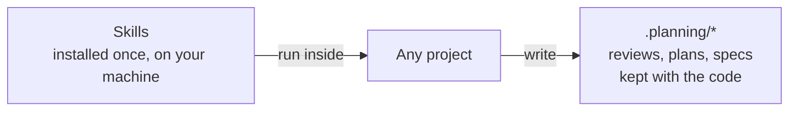
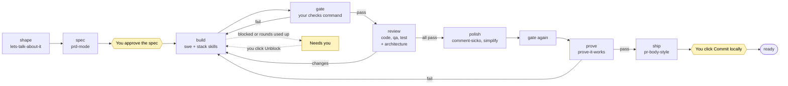

# Agent Skills

A personal library of agent skills: small, single-purpose instruction sets that make an AI coding agent work the way you want. Each skill is a directory with a `SKILL.md` file. [AGENTS.md](AGENTS.md) is the canonical index.

Use one skill on its own, such as `qa-review` on a diff. Or let the [factory](#how-the-factory-works) chain many of them to take a feature from idea to a reviewed local commit.

## Contents

- [The idea](#the-idea)
- [Philosophy](#philosophy)
- [Quick Start](#quick-start)
- [How the factory works](#how-the-factory-works)
- [How factory-review works](#how-factory-review-works)
- [Skills](#skills)
  - [How skills get used](#how-skills-get-used)
  - [Which skill do I use?](#which-skill-do-i-use)
  - [Understand](#understand), [Plan](#plan), [Build](#build), [Review](#review), [Verify and ship](#verify-and-ship), [Write and communicate](#write-and-communicate)
- [Architecture](#architecture)
- [Artifact Convention](#artifact-convention)
- [Contributing a Skill](#contributing-a-skill)
- [Local Setup](#local-setup)
- [Notes](#notes)

## The idea

Three rules hold the whole repo together.

1. **A skill does one thing.** `swe` makes the smallest change. `qa-review` judges maintainability. `prove-it-works` checks the real result. None of them tries to be a workflow.
2. **A workflow is a chain of skills.** `factory` and `factory-review` call other skills as stages. They add no new judgment of their own. They add order, evidence checks, and a place for you to say yes.
3. **You stay in control.** Agents write files and leave code uncommitted. A script checks the files before a job moves on. Only your click on the board approves a spec or commits.



The skills travel with you. The output stays with the project it describes.

## Philosophy

Agent skills are personal. They encode your workflows, your review standards, your testing rituals. They should not live inside a single project.

**Skills travel with the developer.** When a skill lives in `~/.agents`, updating it once updates it everywhere. No per-project installs, no drift between copies. The same review standard applies to your weekend project and your team's monolith.

**Artifacts stay in the project.** Skills are portable. Their output is not. Reviews, plans, and specs describe a specific codebase, so they belong in `.planning/*` inside that project, at the same commit as the code they reference.

**Complex workflows decompose into small skills.** A large workflow is hard to read, test, and reuse. Splitting it into focused sub-skills solves all three. Each sub-skill does one thing; a parent orchestrator chains them together.

**The system must be workspace agnostic.** The same skills work in any project directory. The index and skill conventions assume nothing about the target project. They produce artifacts that are project-aware, but the machinery stays independent.

## Quick Start

Install any skill with the Skills CLI:

```bash
# List available skills
npx skills add ChristopherAlphonse/calphonse-skills --list

# Install all skills
npx skills add ChristopherAlphonse/calphonse-skills --all

# Install a single skill
npx skills add ChristopherAlphonse/calphonse-skills --skill <name>
```

### Updating installed skills

```bash
npx skills update          # interactive
npx skills update -g       # global skills only
npx skills update -p       # project skills only
npx skills update <name>   # one specific skill
npx skills update -y       # no prompts
```

### Your first five minutes

Try the skill that needs the least setup. It reads a repo and writes down what it finds, and never edits your code.

1. Install it: `npx skills add ChristopherAlphonse/calphonse-skills --skill whats-going-on`
2. Open any project in your agent and say: `use whats-going-on on this repo`. In tools with slash commands, `/whats-going-on` does the same.
3. When it finishes, open `.planning/system/`. You will find `architecture.md` (components and flows), `onboard.md` (stack, conventions, concerns, core use cases), and `simplify-onboarding.md` (the same, in plain language).

Then try `qa-review` on a branch with changes. It reviews only the lines you changed and ends with approve or block.

## How the factory works

`factory` takes a feature idea and produces a reviewed commit on a local branch, with a PR body written. It never pushes and never opens a PR or MR.

Each box below is a stage. A fresh agent runs the skill named in it and writes one file. A script, `bin/job`, reads that file and decides whether the job may move on. Gold boxes wait for your click on the board.



Four things make this safe to run unattended:

| Rule                  | What it means                                                                                                                                                                          |
| --------------------- | -------------------------------------------------------------------------------------------------------------------------------------------------------------------------------------- |
| Evidence, not "done"  | An agent saying it finished counts for nothing. `bin/job` advances a job only when the stage's file exists with the right status line, and the gate passes on a command's real output. |
| Fresh agent per stage | Each stage starts with no memory of the last one, so a reviewer never inherits the builder's blind spots.                                                                              |
| Bounded retries       | A job gets `max_rounds` build rounds (default 3), then lands in **Needs you** instead of looping.                                                                                      |
| No push, no PR        | The only commit is the one you trigger. Shell rules block `git push`, `gh`, `glab`, and `curl`, and your remote's protected branches are the real backstop.                            |

Stack skills are picked from file names, not by the agent: TypeScript and React files add `typescript-strict-style` and `vercel-react-best-practices`, C# adds `dotnet`, Python adds `python`.

For the full state machine, the trust model, and setup for Claude Code, Kiro, and OpenCode, read [factory/README.md](factory/README.md). [factory/SKILL.md](factory/SKILL.md) is the contract an agent follows.

## How factory-review works

`factory-review` reviews a branch or diff you already have. It is read-only: it never edits the code, commits, or posts comments.


The verify stage is the point of the design. Reviewers make claims, and a claim can be wrong. The verifier did not write the reviews. It opens every cited line, reruns every command in a scratch copy, and marks each finding confirmed, dropped, or unverifiable. Only confirmed findings reach the report, with paste-ready comments for the MR.

See [factory-review/README.md](factory-review/README.md) for the full state machine and setup.

## Skills

### How skills get used

A skill is a Markdown file the agent reads when a task matches. You can name it in your prompt ("use qa-review on this branch"), type `/qa-review` where the tool supports slash commands, or just describe the task and let the agent match it to a skill's `description`.

Skills are small on purpose, and some call others:

- `simplify` is the shared writing check. `swe`, `pr-body-style`, `documentation-writer`, `performance-review-humanizer`, `factory`, and `factory-review` all point at it.
- `code-review-frontend` falls back to `whats-going-on` when a repo has no codebase map.
- `factory` and `factory-review` call most of the others as stages.

### Which skill do I use?

| I want to                                                  | Use                                                                                                                                                                                                                                                 | Try saying                                          |
| ---------------------------------------------------------- | --------------------------------------------------------------------------------------------------------------------------------------------------------------------------------------------------------------------------------------------------- | --------------------------------------------------- |
| Understand a repo I just joined                            | [whats-going-on](whats-going-on/SKILL.md)                                                                                                                                                                                                           | "What's going on in this repo?"                     |
| Find out if the architecture is over-built or too costly   | [architecture-review](architecture-review/SKILL.md)                                                                                                                                                                                                 | "Review the architecture and where we can cut cost" |
| Stress-test a plan before building it                      | [lets-talk-about-it](lets-talk-about-it/SKILL.md)                                                                                                                                                                                                   | "Let's talk about it: I want to add X"              |
| Write a PRD, or turn one into tasks                        | [prd-mode](prd-mode/SKILL.md)                                                                                                                                                                                                                       | "Help me write a PRD for X"                         |
| Learn whether something is feasible                        | [spike](spike/SKILL.md)                                                                                                                                                                                                                             | "Spike this: can we do X?"                          |
| Make a change with the least code                          | [swe](swe/SKILL.md)                                                                                                                                                                                                                                 | "Fix this, smallest change that works"              |
| Build a whole feature with checkpoints                     | [factory](factory/SKILL.md)                                                                                                                                                                                                                         | "/factory add X"                                    |
| Review my own change for maintainability                   | [qa-review](qa-review/SKILL.md)                                                                                                                                                                                                                     | "QA review my changes"                              |
| Check that my tests would catch a bug                      | [test-review](test-review/SKILL.md)                                                                                                                                                                                                                 | "Are these tests good enough?"                      |
| Review a React or TypeScript PR                            | [code-review-frontend](code-review-frontend/SKILL.md)                                                                                                                                                                                               | "Review this PR"                                    |
| Review a branch end to end and get paste-ready comments    | [factory-review](factory-review/SKILL.md)                                                                                                                                                                                                           | "/factory-review main my-branch"                    |
| Merge several reviews into one fix list                    | [reconcile-reviews](reconcile-reviews/SKILL.md)                                                                                                                                                                                                     | "Reconcile these reviews"                           |
| Confirm work is really done                                | [prove-it-works](prove-it-works/SKILL.md)                                                                                                                                                                                                           | "Prove it works"                                    |
| Strip noisy comments from a diff                           | [comment-sicko](comment-sicko/SKILL.md)                                                                                                                                                                                                             | "Run comment-sicko on this branch"                  |
| Write a short, accurate PR description                     | [pr-body-style](pr-body-style/SKILL.md)                                                                                                                                                                                                             | "Write the PR body"                                 |
| Explain a change out loud to stakeholders                  | [demo-script](demo-script/SKILL.md)                                                                                                                                                                                                                 | "Write a demo script for this"                      |
| Write or fix documentation                                 | [documentation-writer](documentation-writer/SKILL.md)                                                                                                                                                                                               | "Write a how-to for X"                              |
| Get a plain-language version of a reply                    | [simplify](simplify/SKILL.md)                                                                                                                                                                                                                       | "ELI5"                                              |
| Turn a self-review into warmer first-person prose          | [performance-review-humanizer](performance-review-humanizer/SKILL.md)                                                                                                                                                                               | "Humanize my performance review"                    |
| Work with AWS, .NET, React, TypeScript, or a Next.js proxy | [aws](aws/SKILL.md), [dotnet](dotnet/SKILL.md), [vercel-react-best-practices](vercel-react-best-practices/SKILL.md), [typescript-strict-style](typescript-strict-style/SKILL.md), [nextjs-proxy-csp-hardening](nextjs-proxy-csp-hardening/SKILL.md) | Name the stack in your task                         |

### Understand

| Skill                                               | What it does                                                                                                                                                                                                               | Use it when                                                                  |
| --------------------------------------------------- | -------------------------------------------------------------------------------------------------------------------------------------------------------------------------------------------------------------------------- | ---------------------------------------------------------------------------- |
| [whats-going-on](whats-going-on/SKILL.md)           | Reads an unfamiliar repo and writes a map: architecture, 3 to 5 traced flows, stack, conventions, concerns, and core use cases, plus a plain-language copy. Writes to `.planning/system/`. Never edits source.             | You joined a project, or you are about to refactor one you do not know.      |
| [architecture-review](architecture-review/SKILL.md) | Audits a repo for needless complexity, real bottlenecks, reliability risks, and infrastructure cost. Recommends the simplest fix. Every finding is marked `VERIFIED`, `[ASSUMPTION]`, or `[NEEDS MEASUREMENT]`. Read-only. | You want to know if the system is over-built, or what breaks at 10x traffic. |

### Plan

| Skill                                             | What it does                                                                                                                                                                                                                                                                                            | Use it when                                                                                                 |
| ------------------------------------------------- | ------------------------------------------------------------------------------------------------------------------------------------------------------------------------------------------------------------------------------------------------------------------------------------------------------- | ----------------------------------------------------------------------------------------------------------- |
| [lets-talk-about-it](lets-talk-about-it/SKILL.md) | Checks your plan against local code and docs, asks one question at a time, states assumptions, recommends the simplest path, and lists how to verify it. For a big feature it ends with a copy-ready prompt for a separate build session. Does not implement.                                           | A plan, design, or term feels fuzzy and you want it pressure-tested first.                                  |
| [prd-mode](prd-mode/SKILL.md)                     | Helps write a PRD that starts from the problem, sets success metrics, and bounds the scope. Can then turn a finished PRD into a checkable task list in `.planning/tasks/`.                                                                                                                              | You have an idea and need engineering and design to agree on the why.                                       |
| [spike](spike/SKILL.md)                           | Splits an idea into 2 to 5 feasibility questions, sized in story points, and runs one throwaway experiment per question. Ends with a verdict (`VALIDATED`, `PARTIAL`, `INVALIDATED`, `INCONCLUSIVE`) backed by pasted output. Lives in `spikes/`. AWS spikes run on Floci in Docker, never on real AWS. | You ask "is this even possible?" before committing to a build. The deliverable is the answer, not the code. |

### Build

| Skill                                                               | What it does                                                                                                                                                                                   | Use it when                                                    |
| ------------------------------------------------------------------- | ---------------------------------------------------------------------------------------------------------------------------------------------------------------------------------------------- | -------------------------------------------------------------- |
| [swe](swe/SKILL.md)                                                 | Solves the whole task with the least new code: reuse what exists, add no unrequested options, finish every caller and test the change touches. Ends with what it skipped and any risk.         | Any code change where you want a small, complete diff.         |
| [typescript-strict-style](typescript-strict-style/SKILL.md)         | A strict TS/JS discipline: bounded loops, asserted preconditions, explicit error handling, small functions, no unchecked casts, few dependencies. Cites a rule when it flags code.             | You write or review TypeScript or JavaScript.                  |
| [vercel-react-best-practices](vercel-react-best-practices/SKILL.md) | React and Next.js performance rules from Vercel Engineering, plus patterns for components, hooks, state, forms, and accessibility.                                                             | You write, review, or refactor React or Next.js code.          |
| [nextjs-proxy-csp-hardening](nextjs-proxy-csp-hardening/SKILL.md)   | Builds and reviews a secure `proxy.ts`: Content Security Policy, nonces, browser security headers, and migration from `middleware.ts`. Includes a CSP bypass reference for authorized testing. | You add or audit CSP in a Next.js App Router project.          |
| [dotnet](dotnet/SKILL.md)                                           | A router. Picks the guide for ASP.NET Core Web API work (endpoints, DTOs, error middleware, OpenAPI) or for a design pattern review (Command, Factory, Repository, DI, SOLID).                 | You work on C# or .NET.                                        |
| [aws](aws/SKILL.md)                                                 | A router. Picks one guide from 24 (IAM, CDK, CloudFormation, networking, databases, serverless, Bedrock, billing, and more) and loads only that one.                                           | You touch an AWS service, credentials, or infrastructure code. |
| [python](python/SKILL.md)                                           | A router. Picks one guide from 16 (asyncio, pytest, typing, packaging, uv, observability, performance, and more) and loads only that one.                                                      | You write or review Python code.                               |

### Review

Review skills report. They do not edit your code.

| Skill                                                 | What it does                                                                                                                                                                                                                 | Use it when                                                      |
| ----------------------------------------------------- | ---------------------------------------------------------------------------------------------------------------------------------------------------------------------------------------------------------------------------- | ---------------------------------------------------------------- |
| [qa-review](qa-review/SKILL.md)                       | A strict maintainability review of the lines you changed, and only those. Looks for abstraction problems, oversized files, and growing condition chains. Ends with approve or block.                                         | You want a hard look at your own diff before it goes to review.  |
| [test-review](test-review/SKILL.md)                   | Asks whether the tests would notice if the diff were wrong. Runs five focused checks in order (scope, regression, behavior, concurrency, mutation) in a throwaway worktree. Writes to `.planning/reviews/test-review/`.      | You want proof the tests are good, not a count of them.          |
| [code-review-frontend](code-review-frontend/SKILL.md) | Finds the repo's lint, type, and test tooling, then runs specialist reviewers in parallel: a base checklist, TypeScript and React, frontend patterns, and Vercel performance. Every finding is `VERIFIED` or `[ASSUMPTION]`. | You review a frontend PR.                                        |
| [reconcile-reviews](reconcile-reviews/SKILL.md)       | Compares several reviews of one PR, checks their claims against the code, ranks by evidence, and pins each fix to `path:line`. Can post inline MR comments when you ask.                                                     | Two or more reviewers disagree, and you need one list to act on. |
| [factory-review](factory-review/SKILL.md)             | Runs the review skills above as a pipeline and verifies every finding. See [How factory-review works](#how-factory-review-works).                                                                                            | You want a whole branch reviewed and reported.                   |

### Verify and ship

| Skill                                     | What it does                                                                                                                                                                                                                         | Use it when                                                                   |
| ----------------------------------------- | ------------------------------------------------------------------------------------------------------------------------------------------------------------------------------------------------------------------------------------ | ----------------------------------------------------------------------------- |
| [prove-it-works](prove-it-works/SKILL.md) | Checks the real result (run the feature, read the real value, look at the real changes) instead of trusting "it compiles" or an agent's report. Ends by writing a User Acceptance Testing (UAT) document a non-developer can follow. | A task is done and you are about to say so.                                   |
| [comment-sicko](comment-sicko/SKILL.md)   | Hunts narration, banners, commented-out code, and long justifications in a diff. Flags workaround code that needs a real fix as `MUST KILL`. Reports only, and edits comments only when you tell it to.                              | You want a branch free of comment clutter before review.                      |
| [pr-body-style](pr-body-style/SKILL.md)   | Writes a short, business-focused PR body that matches the actual diff and current check status. Keeps your repo's template headings.                                                                                                 | You write, rewrite, or audit a PR description.                                |
| [factory](factory/SKILL.md)               | Chains the skills above into one pipeline from idea to a reviewed local commit. See [How the factory works](#how-the-factory-works).                                                                                                 | You want a whole feature driven end to end, with you approving at two points. |

### Write and communicate

| Skill                                                                 | What it does                                                                                                                                       | Use it when                                                             |
| --------------------------------------------------------------------- | -------------------------------------------------------------------------------------------------------------------------------------------------- | ----------------------------------------------------------------------- |
| [documentation-writer](documentation-writer/SKILL.md)                 | Writes docs in one of four Diátaxis modes (tutorial, how-to, reference, explanation) and never mixes them. Includes product copy principles.       | You write or restructure documentation.                                 |
| [demo-script](demo-script/SKILL.md)                                   | Writes a short spoken script: previously, now, the demonstration, the result, and the business impact. Never invents metrics.                      | You present a change to people who care about the outcome.              |
| [simplify](simplify/SKILL.md)                                         | Restates the last message in plain language: the outcome first, then the one reason that matters.                                                  | You say "I don't follow" or "ELI5".                                     |
| [performance-review-humanizer](performance-review-humanizer/SKILL.md) | Rewrites your first-person self-review in a warmer voice. Keeps every fact and number. Can borrow the style of a sample without copying its words. | You have a draft self-review that reads stiff.                          |

## Architecture

```text
AGENTS.md          Canonical index of all skills
README.md          This file
{skill-name}/
  SKILL.md         Skill instructions and workflow
  references/      Optional deep-dive docs loaded on demand
```

There is no lockfile. Skill versions are tracked by git.

## Artifact Convention

Workflow output goes into `.planning/*` in the target project, not into `docs/`, home directories, or cache folders.

- `.planning/reviews/`: review outputs and readiness summaries
- `.planning/qa/`: QA plans, reports, test outcomes
- `.planning/tasks/TODOS.md`: follow-up work and deferred tasks
- `.planning/strategy/`: product or strategy notes
- `.planning/plans/`, `.planning/requirements/`, `.planning/specs/`: plan inputs

## Contributing a Skill

1. Create `{skill-name}/SKILL.md` with front-matter `name:` matching the folder name and a `description:` written for triggering: say _when_ to use it, not just what it does.
2. Add a row to the index table in [AGENTS.md](AGENTS.md), alphabetical.
3. Add it to the matching category in this README.
4. Keep durable output paths under `.planning/*`.
5. If the skill links to `references/*.md` or an `@`-prefixed external workflow file, commit or verify that target. A missing reference silently disables the workflow.
6. Remove references to tools, folders, or sibling skills that do not exist.
7. Prefer referencing existing skills over copying large blocks.

## Local Setup

To edit a skill and have the change apply globally without reinstalling, symlink the repo into the skill store OpenCode reads:

```bash
REPO=~/calphonse-skills
mkdir -p ~/.config/opencode/skills

for d in "$REPO"/*/; do
  [ -f "$d/SKILL.md" ] || continue
  ln -sfn "${d%/}" ~/.config/opencode/skills/"$(basename "$d")"
done
```

`~/.config/opencode/skills` is the path OpenCode reads (`skills.paths` in `opencode.json`). Edits to any `SKILL.md` take effect immediately. There is no reinstall step and no copy to keep in sync.

Leave `~/.agents/skills` alone: it belongs to the Skills CLI and its lockfile.

## Notes

Skills come from a mix of sources. Some are original, some are adapted from other repos with small changes.
