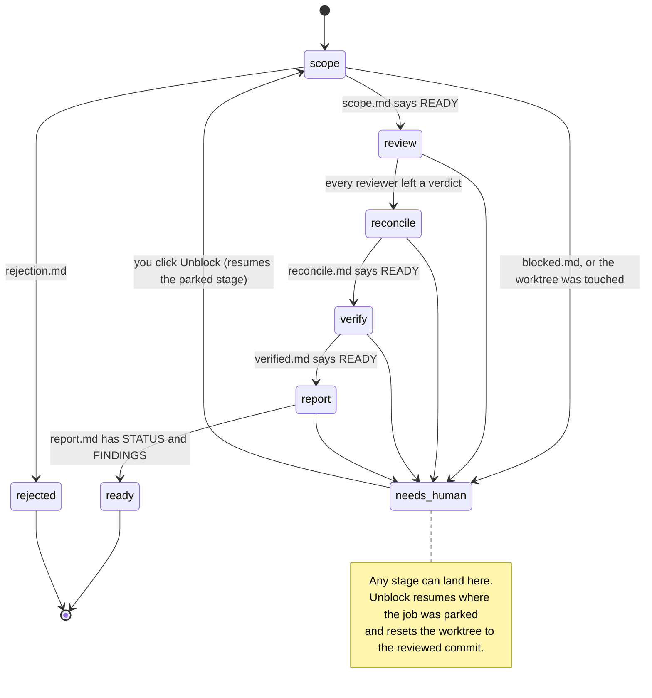
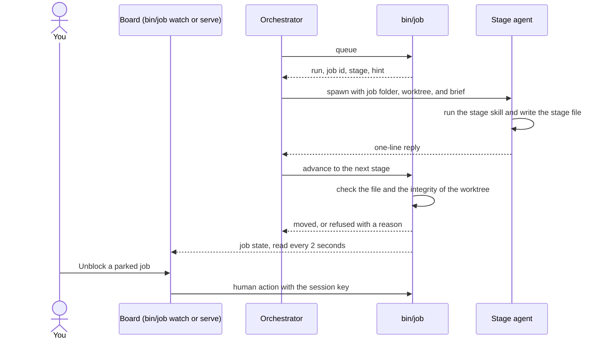

# Factory-review

Factory-review reviews a branch with the review and QA skills in this repo. It scopes the change, runs independent reviewers, merges their findings into one ranked list, checks every finding by rerunning the evidence, and writes a report with comments you paste by hand. A script moves each job from stage to stage and checks the evidence before every move. You follow the work on a kanban board.

It is read-only. It never edits the code under review and never commits. It posts `comments.md` to the MR only when you tell it to, once.

To build a feature, use the separate `factory` skill. The two have the same layout (`bin/job`, `bin/tick`, `dashboard/`, `tests/`) and differ in the workflow: `factory` builds, `factory-review` reviews. Each has its own engine and its own state folder, so neither needs the other installed.

`SKILL.md` is the contract an agent follows. This file explains how the pieces fit.

## Quick start

1. Link `factory-review` and the skills it calls into `~/.claude/skills`: `code-review-frontend`, `qa-review`, `test-review`, `architecture-review`, `reconcile-reviews`, `prove-it-works`, `simplify`, `whats-going-on`, plus `typescript-strict-style`, `vercel-react-best-practices`, `dotnet`, and `python` for those stacks.
2. Install the policy for your harness in the project: `bin/tick install claude`. It comes from `policy.yaml`.
3. Fetch the branch you want reviewed. The review never reaches a forge:

   ```
   git fetch origin pull/42/head:pr-42
   ```

4. In Claude Code, run `/factory-review main pr-42`. Or create the job yourself:

   ```
   ~/.claude/skills/factory-review/bin/job create pr-42-review "Review PR 42" main pr-42
   ```

5. Follow along on the board. `create` and `queue` print its link. `bin/job board` prints it again.
6. Keep passes going with `/loop 5m /factory-review run`, or schedule `bin/tick claude` with cron.
7. When the job reaches Ready to land, read `.planning/factory-review/jobs/pr-42-review/report.md` and paste the comments from `comments.md` into the MR yourself.

Gitignore `.planning/` and `.worktrees/` in the project.

Other keys for `.planning/factory-review/config.json`: `concurrency` (default 1), `auto_watch` (set `false` to stop the board starting by itself), and `allow` (extra shell patterns reviewers may run unattended, such as `make verify*`). Reviewers can already run the common test, lint, and type-check commands. Run `bin/tick install` after changing `allow`.

## How a review moves

Every review is a card on the board. It sits in one stage at a time. No stage waits for a click. Only a parked job does.



Each stage runs the skill that owns it. A fresh subagent does the work and writes one file with a status line first. `bin/job advance` reads that line and refuses the move if it is missing.

| Stage | Skill | File it writes |
| --- | --- | --- |
| scope | the repo's own tooling discovery | `scope.md` |
| review | a `code` reviewer whose skill follows the diff (`code-review-frontend` for TS/JS/React only, `python`, `dotnet`, `aws`), `qa-review`, `test-review`, and `architecture-review` when routed | `reviews/review-<name>.md` |
| reconcile | `reconcile-reviews` (merge step only) | `reconcile.md` |
| verify | `prove-it-works` on the findings | `verified.md` |
| report | `simplify` | `report.md` and `comments.md` |

## One pass

A pass is one run of `/factory-review run` or `bin/tick`. The orchestrator asks the script what to do, spawns agents, and lets the script judge the results. A pass ends when nothing is left to run. Everything is in files, so the next pass resumes every job.



`bin/job queue` marks each job `run`, `hold` (parked, waiting on you), `wait` (over the concurrency cap), or `done`. The orchestrator acts only on `run`.

## Why there is a verify stage

Reviewers make claims. A claim can be wrong, or run against code that is not what was reviewed. The verifier did not write the reviews. It opens every cited line, reruns every command in a scratch copy, and marks each finding confirmed, dropped, or unverifiable. Only confirmed findings reach the report.

## The report

`report.md` begins with three lines the engine checks:

```
STATUS: READY
FINDINGS: 10
BLOCKERS: 3
```

Then it has a summary with a recommendation and the ranked findings. `comments.md` has one comment per finding, each starting with `file:line`. The board card shows the two counts.

## Stack skills

`bin/job` chooses the skills for the codebase from the file names in the diff. An agent does not judge it. The result is stored in `job.json`, shown on the card, and printed in `bin/job queue`.

| Files in the diff | Skill |
| --- | --- |
| `.ts`, `.tsx`, `.js`, `.jsx` | `typescript-strict-style` |
| `.tsx`, `.jsx`, `next.config.*` | `vercel-react-best-practices` |
| `proxy.ts`, `middleware.ts` | `nextjs-proxy-csp-hardening` |
| `.cs`, `.csproj`, `.sln`, `.cshtml`, `.razor` | `dotnet` |
| `.py`, `.pyi`, `pyproject.toml`, `uv.lock` | `python` |
| `.tf`, `cdk.json`, `serverless.yml` | `aws` |

## Following along

One board, started with `bin/job board` by you, an agent, or `create` and `queue` on their own. It has the Unblock button, a skill switch and note per review, and a chat bar. `watch` and `serve` are the same board. Its link works in several tabs until the process stops.

`unblock` is not a CLI command. It runs only from the board. The board binds to localhost and prints a code in its link. The code becomes a session cookie. Every action also needs a custom header and a loopback `Host`. The key lives only in the server's memory, and the git hooks check its hash.

## Safety layers

The layers differ in strength. Only your remote's rules stop an agent that runs as you.

| Layer | What it does | Strength |
| --- | --- | --- |
| Policy from `bin/tick` (`policy.yaml` plus a stricter deny list, and file-write limits) | stop the agent running commit, push, merge, rebase, cherry-pick, revert, am, commit-tree, update-ref, symbolic-ref, config, fast-import, git global options (`-c`, `-C`), `gh`, `glab`, `curl`, `wget`, and `sh -c` | Measured on Claude Code for `factory`, which uses the same list: 24 of 24 attack spellings blocked. A script that shells out is not covered |
| Integrity checks in `bin/job` | detect a moved branch tip, an edited tracked file, changed hooks, a detached HEAD, or `job.json` that disagrees with the audit log | Detects, does not prevent. Parks the job on you |
| Git hooks in each worktree | refuse commits, pushes, and ref moves without the board's key, and chain to the repo's own hooks | A speed bump. `git -c core.hooksPath=/dev/null` and `push --no-verify` get past them |
| Board key and session | keep unblock out of the CLI | Stops an agent using the CLI. A process running as you could open its own terminal |
| `bin/tick` | refuses a headless pass unless the policy is installed | Hard, for the runs it starts |
| Branch protection on your remote | the only layer outside the agent's reach | Turn it on for every repo you review |

If a tracked file changes or the branch moves, the job parks on you. Unblock restores the reviewed commit and resumes the parked stage. Untracked scratch files, such as test output, do not park a job.

## Files

State lives in the project, never in this repo.

| Path | Holds |
| --- | --- |
| `.planning/factory-review/config.json` | `concurrency`, `auto_watch`, `allow` |
| `.planning/factory-review/jobs/<id>/job.json` | the job's state, written only by `bin/job`. It records the base and head commits under `review` |
| `.planning/factory-review/jobs/<id>/*.md` | the stage files from the table above |
| `.planning/factory-review/jobs/<id>/reviews/` | one `review-<name>.md` per reviewer |
| `.planning/factory-review/scratch/<id>/<reviewer>/` | copies reviewers use to run experiments |
| `.planning/factory-review/audit.log` | one JSON line per state change, with the actor (`agent`, `human`, or `tick`) |
| `.planning/factory-review/hooks/<id>/` | the per-worktree git hooks |
| `.worktrees/<id>/` | the reviewed commit, checked out locally on the branch `factory-review/<id>` |

## Commands

| Command | Does |
| --- | --- |
| `bin/job create <id> "<title>" <base> <head>` | start a review job at scope |
| `bin/job queue` | list jobs as `action id stage hint` |
| `bin/job advance <id> <stage>` | move a job if the evidence allows it |
| `bin/job route <id> architecture` | add a reviewer |
| `bin/job note <id> "<text>"` | record what the agent is doing now; the card shows the latest note |
| `bin/job board` | print the link of the board, starting it if needed |
| `bin/job serve [port]` / `bin/job watch [port]` | run the board in the foreground (default ports 8765 / 8766) |
| `bin/job skill <id> <name> on\|off` | switch a skill off or on for one review |
| `bin/job brief <id> <stage> <text>` | set a note the reviewers for that stage follow (empty text clears) |
| `bin/tick <harness> [--dry-run]` | run one headless pass if the policy is installed |
| `bin/tick install`, `check`, `print`, `list` | install, verify, show, or list the policy |

## Harnesses

Kiro, Claude Code and OpenCode get the same policy and the same guard. `tick install <harness>` writes the harness's own rules, plus `bin/guard` as a tool-call hook (a Kiro `PreToolUse` hook, a Claude Code `PreToolUse` hook, an OpenCode `tool.execute.before` plugin). The hook exists because each harness has a mode that skips its own prompts (Kiro `--trust-all-tools`, Claude Code bypass mode) and none of them can say "everything except". A hook still runs. The guard applies deny, then ask, then allow to every shell segment of a command, treats a command no rule names as blocked, checks redirect targets and file-tool writes against the protected paths, and limits the review agent to writing under `.planning/factory-review/`, and exits 2 on any input it cannot read. `tick check <harness>` fails if the hook or its rules file differ from `tick print <harness>`. What is measured: on Kiro (v3 engine, `kiro-cli` 3.3.0) every conclusive attack in `tests/probe_harness.py` was blocked under `--trust-all-tools`, each succeeding in a control with no policy. Claude Code's deny rules were measured earlier (24 of 24), but its hook and the OpenCode plugin were not run against the real CLIs, since neither is installed where this was built. Their guard logic is unit-tested with each harness's tool names, and the OpenCode plugin is loaded under Node, so run `tests/probe_harness.py claude` and `tests/probe_harness.py opencode` before trusting either. Not covered on any harness: an allowed program that writes files by itself (a build tool), and sub-agents, whose hooks were not tested. The `JOB` integrity checks catch those. `TICK` passes no trust or bypass flag.

Measure a harness before trusting it with `tests/probe_harness.py <harness>`. It runs each attack with and without the policy in a scratch repo and reports BLOCKED, GAP, or INCONCLUSIVE. A canary check refuses to attack until the harness is proven to be inside the scratch repo.

## Tests

Quick subset (guard, policy, and the board build check), in parallel:

```
python3 factory-review/tests/run.py
```

Every test, in parallel:

```
python3 factory-review/tests/run.py all
```

`--workers N` overrides the worker count; the default is up to 8. The unit is a test class, and the fixed-port `test_autowatch` classes share one worker. The serial command stays authoritative:

```
python3 -m unittest discover -s factory-review/tests
```

136 tests. The quick subset covers the logic that does not need a git repo or an HTTP server, so it runs in seconds. The full run takes minutes because most tests start `git` or `python3 -I bin/job` as a subprocess. `test_job.py` covers creating a review, the stage rules, stack detection, the read-only guarantees, the audit log, and the board. `test_integrity.py` replays the bypasses a red-team agent found against `factory`. `test_watch.py` and `test_autowatch.py` cover the read-only board, and `test_tick.py` covers the deny rules.

## Notes on the allow list

The allow list is a set of command patterns. It cannot see what a command does inside. Read these before you rely on it.

- **Scripts that fix files.** A lint or format script in `package.json` that internally runs `--fix` is invisible to the policy, because the policy only sees `npm run lint`. In a review, the integrity check catches the changed tracked file and parks the job. It does not prevent the edit. Unblock restores the reviewed commit.
- **`rubocop -A`.** Only the long flags `--autocorrect` and `--auto-correct` ask first. The short flag `-A` is not covered.
- **`dotnet build` and `dotnet test`.** Both restore packages, so they can use the network. They are allowed because they do not work otherwise.

## Limits

- The review skills have only been exercised in miniature. Run a real review before relying on the depth of each one.
- The verify stage is only as good as what can be run locally. A finding that needs a service you do not have comes back unverifiable.
- An agent running as your user can still edit files and run git. The engine makes that visible. Branch protection on your remote is the real guarantee.
- Running tests runs the project's code. The policy sees the test command, not what the tests do inside it. A review of a branch you do not trust is therefore code execution on your machine. The worktree hooks and the integrity checks catch a commit or an edit to tracked files, not a network call or a write outside the worktree.
- The ask rules are enforced by the harness, and no human is there to answer one in an unattended pass. That is the intent. Only Claude Code's handling is known to me from its documentation. Kiro refuses an `ask` in a headless run. Under `--trust-all-tools` the `kiro-guard` hook blocks it. OpenCode's handling is unmeasured.
- A command the allow list permits can still write a file through shell redirection (`echo x > file`). The file-write rules cover the harness's edit tools, not the shell. For a review, the integrity check catches a changed tracked file and parks the job. It detects, it does not prevent.
- The deny-rule measurement was done on `factory`. The list is the same, but the probe has not been rerun for `factory-review`.

## Board source

The board is the same canvas UI as `factory`, written in TypeScript in `dashboard/*.ts`. The server reads the generated `dashboard/dist/*.js`, which is committed and never edited by hand. `serve` and `watch` rebuild `dist/` at start when Node 24 or later is on PATH and a `.ts` is newer. Otherwise they warn once, log it in `audit.log`, and serve the committed `dist/`. To build by hand, run `node factory-review/dashboard/build.mjs`. Add `--check` to fail on a stale `dist/`, as `tests/test_dashboard_build.py` does. A running board does not reload, so restart it after you edit a `.ts` file.
