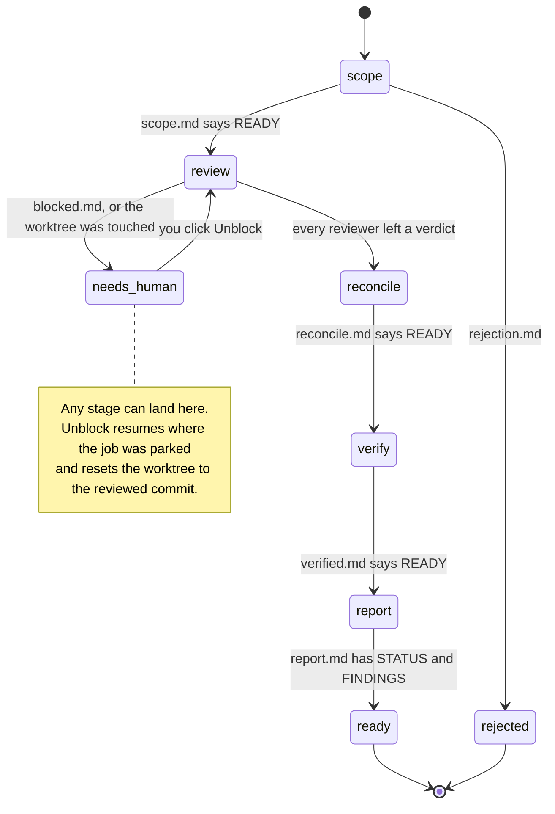

# Factory-test

Factory-test reviews a branch with the review and QA skills in this repo. It scopes the change, runs independent reviewers, merges their findings into one ranked list, checks every finding by rerunning the evidence, and writes a report with comments you paste by hand.

It is read-only. It never edits the code under review and never posts to a forge.

`SKILL.md` is the contract an agent follows. This file explains how the pieces fit.

It is a separate skill from `factory`, which builds features. The two share one engine, `factory/bin/job`, and one board. Install both.

## Quick start

1. Link `factory`, `factory-test`, and the skills below into `~/.claude/skills`: `code-review-frontend`, `qa-review`, `test-review`, `security-review`, `architecture-review`, `reconcile-reviews`, `prove-it-works`, `unslop`, plus `typescript-strict-style`, `vercel-react-best-practices`, and `dotnet` for those stacks.
2. Fetch the branch you want reviewed. The factory never reaches a forge:

   ```
   git fetch origin pull/42/head:pr-42
   ```

3. In Claude Code, run `/factory-test main pr-42`. Or create the job yourself:

   ```
   ~/.claude/skills/factory/bin/job create pr-42-review "Review PR 42" --review main pr-42
   ```

4. Follow along on the read-only board: `~/.claude/skills/factory/bin/job watch`, then open the link it prints.
5. When the job reaches Ready to land, read `.planning/factory/jobs/pr-42-review/report.md` and paste the comments from `comments.md` into the MR yourself.

Gitignore `.planning/` and `.worktrees/` in the project.

## How a review moves



Each stage runs the skill that owns it. A fresh subagent does the work and writes one file with a status line first. `bin/job advance` reads that line and refuses the move if it is missing.

| Stage | Skill | File it writes |
| --- | --- | --- |
| scope | `code-review-frontend` step 0 | `scope.md` |
| review | `code-review-frontend` (plus `dotnet` for C#), `qa-review`, `test-review`, and `security-review` or `architecture-review` when routed | `round-1/review-<name>.md` |
| reconcile | `reconcile-reviews` (merge step only) | `reconcile.md` |
| verify | `prove-it-works` on the findings | `verified.md` |
| report | `unslop` | `report.md` and `comments.md` |

## Why there is a verify stage

Reviewers make claims. A claim can be wrong, or run against code that is not what was reviewed. The verifier did not write the reviews. It opens every cited line, reruns every command in a scratch copy, and marks each finding confirmed, dropped, or unverifiable. Only confirmed findings reach the report.

## The report

`report.md` begins with three lines the engine checks:

```
STATUS: READY
FINDINGS: 10
BLOCKERS: 3
```

Then it has a summary with a recommendation and the ranked findings. `comments.md` has one comment per finding, each starting with `file:line`. The board card shows the two counts.

## Stack skills

`bin/job` chooses the skills for the codebase from the file names in the diff. An agent does not judge it. The result is stored in `job.json`, shown on the card, and printed in `bin/job queue`.

| Files in the diff | Skill |
| --- | --- |
| `.ts`, `.tsx`, `.js`, `.jsx` | `typescript-strict-style` |
| `.tsx`, `.jsx`, `next.config.*` | `vercel-react-best-practices` |
| `proxy.ts`, `middleware.ts` | `nextjs-proxy-csp-hardening` |
| `.cs`, `.csproj`, `.sln`, `.cshtml`, `.razor` | `dotnet` |
| `.tf`, `cdk.json`, `serverless.yml` | `aws` |

## What it will not do

- Edit, commit, or reset the code under review. The worktree is at the exact reviewed commit. If a tracked file changes or the branch moves, the job parks on you. Unblock restores the reviewed commit.
- Post a comment, review, or approval anywhere. `reconcile-reviews` can post inline MR comments, and this workflow uses only its merge step.
- Fix what it finds. Use `factory` for changes.
- Run any git write command, forge CLI, or network call. Harness deny rules from `bin/tick` back this up. See the `factory` README for how each safety layer is enforced and how far to trust it.

## Files

State lives in the project, never in this repo.

| Path | Holds |
| --- | --- |
| `.planning/factory/jobs/<id>/job.json` | the job's state, written only by `bin/job`. It records the base and head commits under `review` |
| `.planning/factory/jobs/<id>/*.md` | the stage files from the table above |
| `.planning/factory/scratch/<id>/<reviewer>/` | copies reviewers use to run experiments |
| `.planning/factory/audit.log` | one JSON line per state change |
| `.worktrees/<id>/` | the reviewed commit, checked out locally on the branch `factory/<id>` |

## Tests

The engine and the review workflow are tested together with `factory`:

```
python3 -m unittest discover -s factory/tests
```

`factory/tests/test_review_workflow.py` covers the stage rules, stack detection, and the read-only guarantees.

## Limits

- The review skills ran in miniature in the end-to-end test. Run a real review before relying on the depth of each one.
- The verify stage is only as good as what can be run locally. A finding that needs a service you do not have comes back unverifiable.
- An agent running as your user can still edit files and run git. The engine makes that visible. Branch protection on your remote is the real guarantee.
