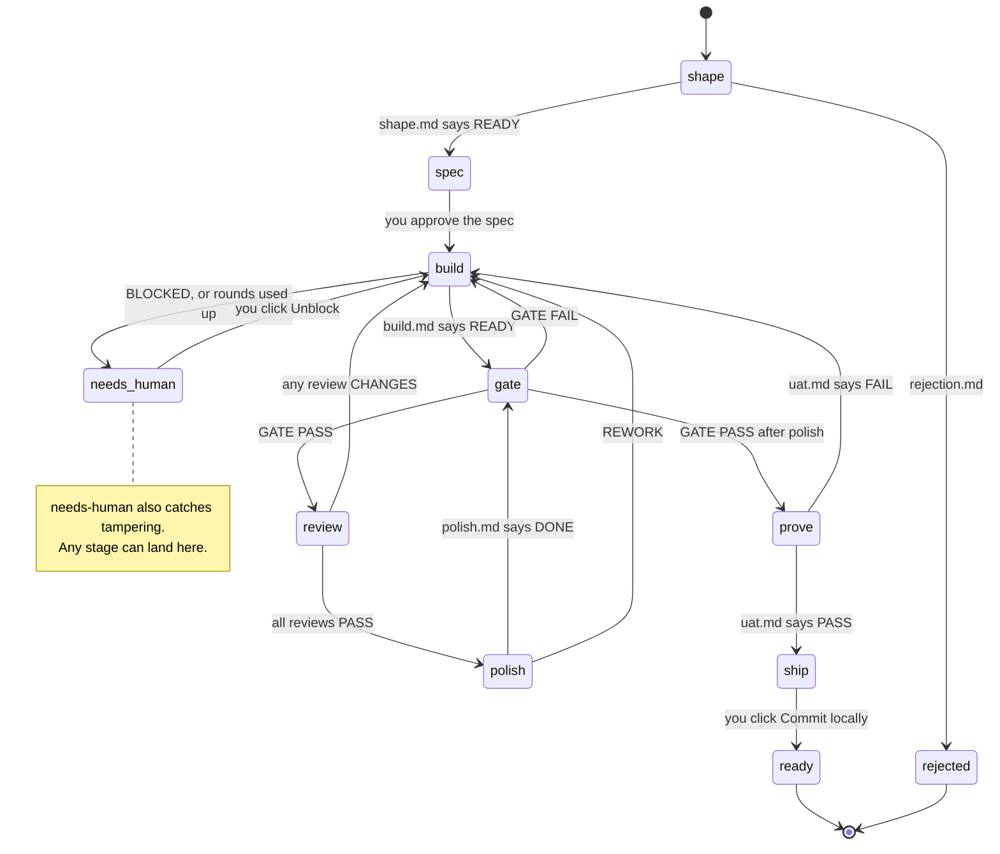
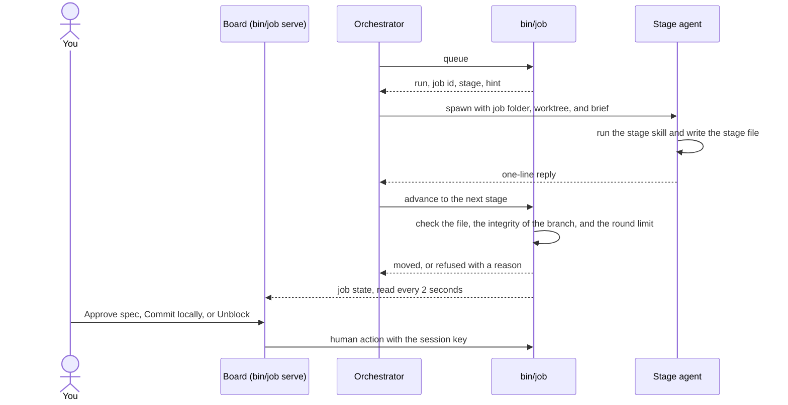
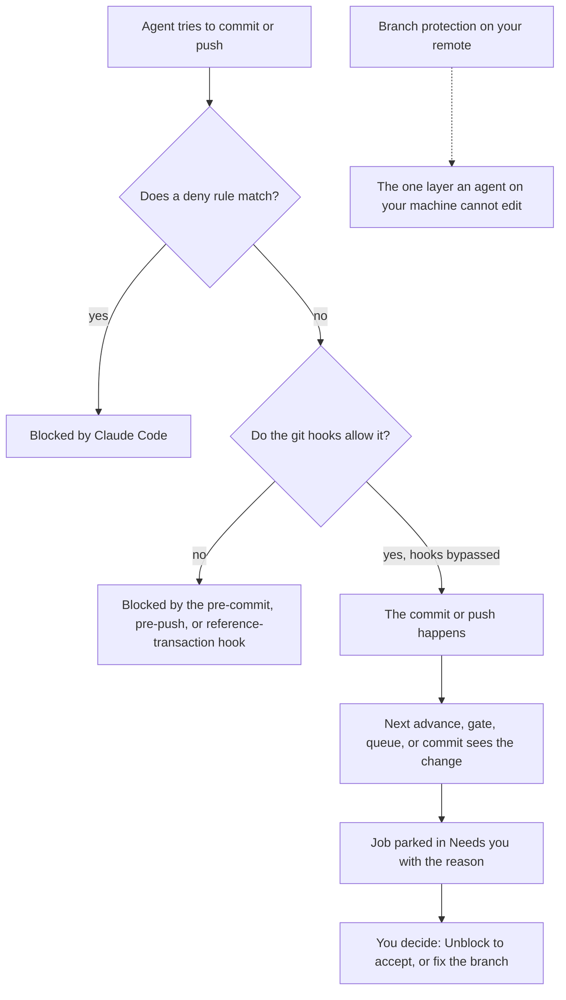

# Factory

The factory takes a feature from idea to a reviewed, committed change on a local branch. It does this by chaining the other skills in this repo as stages. A script moves each job from stage to stage and checks the evidence before every move. You follow the work, approve, and chat on a board of connected stages.

It never pushes and never opens a PR or MR. The only commit is the one you make by clicking a button on the board.

To review an existing branch, use the separate `factory-review` skill. It has the same layout, its own engine and board, and never writes code.

`SKILL.md` is the contract an agent follows. This file explains how the pieces fit.

## Quick start

1. Link the factory and the skills it calls into `~/.claude/skills`: `factory`, `lets-talk-about-it`, `prd-mode`, `swe`, `code-review-frontend`, `qa-review`, `test-review`, `comment-sicko`, `prove-it-works`, `pr-body-style`, plus the stack skills you use.
2. In the project, create `.planning/factory/config.json` and set the command that must pass before review:

   ```json
   { "checks": "npm test" }
   ```

   Other keys: `concurrency` (default 1), `max_rounds` (default 3), `base_branch` (default `main`), extra `protected_paths`, and `allow` (extra shell patterns the agents may run unattended, such as `make verify*`; your `checks` command is allowed already). Test, lint, format-check, and quality tools for the common stacks are allowed by `policy.yaml`. Formatters that rewrite files are in `policy.build.yaml`, which only this skill loads.
3. Install the policy for your harness: `bin/tick install claude`. It comes from `policy.yaml`.
4. Start a job in Claude Code with `/factory <feature idea>`.
5. Open the board with `bin/job board`, then open the address it prints.
6. Keep passes going, including after you click approve, commit, or unblock: run `bin/tick loop kiro` (or `claude`, `opencode`) in a spare terminal. Or use `/loop 5m /factory run`, or schedule `bin/tick claude` with cron.

Gitignore `.planning/` and `.worktrees/` in the project.

## How a job moves

Every job is a card on the board. It sits in one stage at a time. The two stages marked **you** wait for a click on the board. Everything else needs evidence in a file.



Each stage runs the skill that owns it. A fresh subagent does the work and writes one file with a status line first. `bin/job advance` reads that line and refuses the move if the evidence is missing.

| Stage | Skill | File it writes | Next move needs |
| --- | --- | --- | --- |
| shape | `lets-talk-about-it` | `shape.md` | `STATUS: READY` |
| spec | `prd-mode` | `spec.md` | your approval on the board |
| build | `swe` plus stack skills | `build.md` | `STATUS: READY`, changes left uncommitted |
| gate | `bin/job gate` (a script) | `round-N/checks.md` | `GATE: PASS` |
| review | a `code` reviewer whose skill follows the diff (`code-review-frontend` for TS/JS/React only, `python`, `dotnet`, `aws`), `qa-review`, `test-review`, plus `architecture-review` when the diff calls for it | `round-N/review-<name>.md`, then `reconcile.md` if anything is CHANGES | `VERDICT: PASS` from every reviewer |
| polish | `comment-sicko`, then `simplify` | `polish.md` | `STATUS: DONE`, then a fresh gate run |
| prove | `prove-it-works` | `uat.md` | `STATUS: PASS` |
| ship | `pr-body-style` | `pr-body.md` and `commit.md` | your Commit locally click |

A job gets `max_rounds` build rounds. After that it moves to **Needs you** instead of looping. Editing `spec.md` after you approve it blocks the build until you approve again.

## Stack skills

`bin/job` picks the skills for the codebase from file names. You do not choose them, and an agent does not judge them. The choice is stored in `job.json`, shown on the card, and printed in `bin/job queue`.

| Files in the repo (build) or the diff (review) | Skill |
| --- | --- |
| `.ts`, `.tsx`, `.js`, `.jsx` | `typescript-strict-style` |
| `.tsx`, `.jsx`, `next.config.*` | `vercel-react-best-practices` |
| `proxy.ts`, `middleware.ts` | `nextjs-proxy-csp-hardening` |
| `.cs`, `.csproj`, `.sln`, `.cshtml`, `.razor` | `dotnet` |
| `.py`, `.pyi`, `pyproject.toml`, `uv.lock` | `python` |
| `.tf`, `cdk.json`, `serverless.yml` | `aws` |

## One pass

A pass is one run of `/factory run` or `bin/tick`. The orchestrator asks the script what to do, spawns agents, and lets the script judge the results. A pass ends when nothing is left to run. Everything is in files, so the next pass resumes every job.



`bin/job queue` marks each job `run`, `hold` (waiting on you), `wait` (over the concurrency cap), or `done`. The orchestrator acts only on `run`.

## Following along

One board, started with `bin/job board` by you or an agent. It has the Approve spec, Commit locally and Unblock buttons, holds the approval key in memory, and its link works in several tabs until the process stops.

`watch` and `serve` are the same board: buttons, a skill switch and note per job, and a chat bar.

## Who can do what

| Action | Agent | You, on the board |
| --- | --- | --- |
| Create, advance, gate, route, progress | yes, through `bin/job` | no need |
| Edit code in the worktree | yes, uncommitted | |
| Approve the spec | no | yes |
| Commit | no | yes, one click |
| Unblock a parked job | no | yes |
| Push, open a PR or MR | no | your own step, outside the factory |

`approve`, `commit`, and `unblock` are not CLI commands. They run only from the board.

The board binds to localhost and prints a code in its link. The code becomes a session cookie. Every action also needs a custom header and a loopback `Host`. The approval key lives only in the server's memory, and the git hooks check its hash.

The commit click refuses unless all of these hold:

- the gate passed this round, and the working tree is the one that passed
- the branch holds no commit the board did not make
- no protected path was touched
- the repo's own hooks pass

## Safety layers

The layers differ in strength. Only your remote's rules stop an agent that runs as you.



| Layer | What it does | Strength |
| --- | --- | --- |
| Policy from `bin/tick` (`policy.yaml` plus a stricter deny list, and file-write limits) | stop the agent running commit, push, merge, rebase, cherry-pick, revert, am, commit-tree, update-ref, symbolic-ref, config, fast-import, git global options (`-c`, `-C`), `gh`, `glab`, `curl`, `wget`, and `sh -c` | Measured on Claude Code: 24 of 24 attack spellings blocked, each succeeding in a no-policy control. A script that shells out is not covered |
| Integrity checks in `bin/job` | detect a moved branch tip, changed hooks, a commit on a remote ref, a detached HEAD, or `job.json` that disagrees with the audit log | Detects, does not prevent. Parks the job on you |
| Git hooks in each worktree | refuse commits and pushes without the board's key, and chain to the repo's own hooks | A speed bump. `git -c core.hooksPath=/dev/null` and `push --no-verify` get past them |
| Board key and session | keep approve, commit, and unblock out of the CLI | Stops an agent using the CLI. A process running as you could open its own terminal |
| Protected paths | fail the gate when the diff touches CI config, CODEOWNERS, `.env`, hook config, and similar | Hard, for jobs the factory runs |
| `bin/tick` | refuses a headless pass unless the policy is installed | Hard, for the runs it starts |
| Branch protection on your remote | the only layer outside the agent's reach | Turn it on for every repo the factory touches |

## Files

State lives in the project, never in this repo.

| Path | Holds |
| --- | --- |
| `.planning/factory/config.json` | `checks`, `concurrency`, `max_rounds`, `base_branch`, `protected_paths`, `allow` |
| `.planning/factory/jobs/<id>/job.json` | the job's state, written only by `bin/job` |
| `.planning/factory/jobs/<id>/*.md` | the stage files from the table above |
| `.planning/factory/audit.log` | one JSON line per state change, with the actor (`agent`, `human`, or `tick`) |
| `.planning/factory/hooks/<id>/` | the per-worktree git hooks |
| `.worktrees/<id>/` | the job's branch, `factory/<id>`, checked out locally |

## Dashboard source

The board is written in TypeScript, in `dashboard/*.ts`. The server reads the generated `dashboard/dist/*.js`, which is committed and never edited by hand. `serve` and `watch` rebuild `dist/` at start when Node is on PATH and a `.ts` is newer than its `.js`. When a source is newer or a dist file is missing, and Node is absent or the build fails, they print one `dashboard:` warning, log it in `audit.log`, and serve the committed `dist/`. To build by hand, run `node factory/dashboard/build.mjs`, which needs Node 24 or later. `node factory/dashboard/build.mjs --check` fails when a `dist/*.js` is stale, missing or has no `.ts`, and `tests/test_dashboard_build.py` runs it. A running board does not reload, so restart it after you edit a `.ts` file. Only erasable syntax is allowed: no `enum`, `namespace` or constructor parameter properties. `dashboard/tsconfig.json` is for running `tsc` by hand and needs TypeScript 5.8 or later (`erasableSyntaxOnly`). Nothing runs it for you.

## Commands

| Command | Does |
| --- | --- |
| `bin/job create <id> "<title>"` | start a build job at shape |
| `bin/job create <id> "<title>" --review BASE HEAD` | start a review job at scope. Left over from before the split: `factory-review` has its own engine and no longer uses it |
| `bin/job stack <id>` | recompute the stack skills for a job |
| `bin/job queue` | list jobs as `action id stage hint` |
| `bin/job advance <id> <stage>` | move a job if the evidence allows it |
| `bin/job gate <id>` | run `checks` in the worktree and record the result and tree hash |
| `bin/job route <id> architecture` | add a reviewer |
| `bin/job progress <id> <done> <total>` | set the task progress bar |
| `bin/job note <id> "<text>"` | record what the agent is doing now; the card shows the latest note |
| `bin/job serve [port]` / `bin/job watch [port]` | run the board in the foreground (default ports 8765 / 8766) |
| `bin/job skill <id> <name> on\|off` | switch a skill off or on for one job |
| `bin/job brief <id> <stage> <text>` | set a note the next agent for that stage follows (empty text clears) |
| `bin/tick <harness> [--dry-run]` | run one headless pass if the policy is installed |
| `bin/tick loop <harness> [seconds] [--once]` | run a pass whenever a job can run, so your board click continues the work by itself |
| `bin/tick install`, `check`, `print`, `list` | install, verify, show, or list the policy |

## Harnesses

Kiro, Claude Code and OpenCode get the same policy and the same guard. `tick install <harness>` writes the harness's own rules, plus `bin/guard` as a tool-call hook (a Kiro `PreToolUse` hook, a Claude Code `PreToolUse` hook, an OpenCode `tool.execute.before` plugin). The hook exists because each harness has a mode that skips its own prompts (Kiro `--trust-all-tools`, Claude Code bypass mode) and none of them can say "everything except". A hook still runs. The guard applies deny, then ask, then allow to every shell segment of a command, treats a command no rule names as blocked, checks redirect targets and file-tool writes against the protected paths, and exits 2 on any input it cannot read. `tick check <harness>` fails if the hook or its rules file differ from `tick print <harness>`. What is measured: on Kiro (v3 engine, `kiro-cli` 3.3.0) every conclusive attack in `tests/probe_harness.py` was blocked under `--trust-all-tools`, each succeeding in a control with no policy. Claude Code's deny rules were measured earlier (24 of 24), but its hook and the OpenCode plugin were not run against the real CLIs, since neither is installed where this was built. Their guard logic is unit-tested with each harness's tool names, and the OpenCode plugin is loaded under Node, so run `tests/probe_harness.py claude` and `tests/probe_harness.py opencode` before trusting either. Not covered on any harness: an allowed program that writes files by itself (a build tool), and sub-agents, whose hooks were not tested. The `JOB` integrity checks catch those. `TICK` passes no trust or bypass flag.

| | Claude Code | OpenCode | Kiro |
| --- | --- | --- | --- |
| Skills dir | `.claude/skills` | `.agents/skills` | `.kiro/skills` |
| Headless pass | `claude -p` | `opencode run` | `kiro-cli chat --v3 --no-interactive --agent factory` |
| Policy | `.claude/settings.json`, `.claude/hooks/` | `opencode.jsonc`, `.opencode/plugins/`, `.opencode/guard/` | `.kiro/agents/factory.json`, `.kiro/hooks/` |

On Claude Code, 24 of 24 attacks were blocked, each succeeding in the no-policy control. On OpenCode only 4 attacks had a valid control, and all 4 were blocked.

Keep skill frontmatter to `name` and `description`, with `name` equal to the folder name. Kiro requires that.

Measure a harness before trusting it with `tests/probe_harness.py <harness>`. It runs each attack with and without the policy in a scratch repo and reports BLOCKED, GAP, or INCONCLUSIVE. A canary check refuses to attack until the harness is proven to be inside the scratch repo.

## Tests

```
python3 -m unittest discover -s factory/tests
```

123 tests, one skipped for a non-loopback bind. The run takes about two minutes. `test_job.py` covers the stages and the board, `test_integrity.py` replays the bypasses a red-team agent found, and `test_tick.py` covers the deny rules.

## Notes on the allow list

The allow list is a set of command patterns. It cannot see what a command does inside. Read these before you rely on it.

- **Scripts that fix files.** A lint or format script in `package.json` that internally runs `--fix` is invisible to the policy, because the policy only sees `npm run lint`. For a build job this is allowed to change files, so nothing parks the job. The gate and the reviewers see the result.
- **`rubocop -A`.** `bundle exec rubocop*` is allowed as written, so builders can autocorrect with `-A` or the long flags.
- **`dotnet build` and `dotnet test`.** Both restore packages, so they can use the network. They are allowed because they do not work otherwise.

## Limits

- An agent that runs as your user can still edit files and run git. The factory makes that visible and stops the ordinary paths. Branch protection on the remote is the real guarantee.
- Running tests runs the project's code. The policy sees the test command, not what the tests do inside it. A review of a branch you do not trust is therefore code execution on your machine. The worktree hooks and the integrity checks catch a commit or an edit to tracked files, not a network call or a write outside the worktree.
- The ask rules are enforced by the harness, and no human is there to answer one in an unattended pass. That is the intent. Only Claude Code's handling is known to me from its documentation. Kiro refuses an `ask` in a headless run. Under `--trust-all-tools` the `kiro-guard` hook blocks it. OpenCode's handling is unmeasured.
- A command the allow list permits can still write a file through shell redirection (`echo x > file`). The file-write rules cover the harness's edit tools, not the shell. The integrity checks catch a commit, a moved branch, or changed hooks, and park the job. They detect, they do not prevent.
- The gate is only as good as your `checks` command. Make sure it fails when no tests run.
- The stage skills run as full skills in real use. Testing so far used shortened versions to check the factory's contract.
