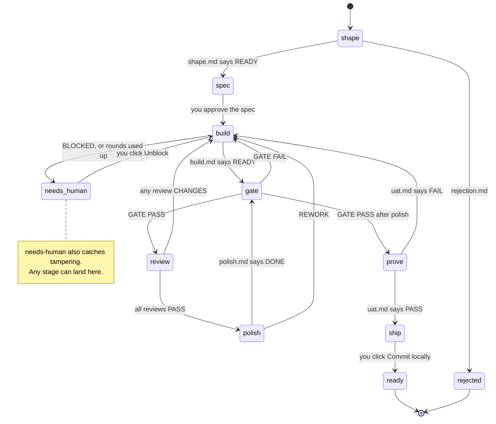
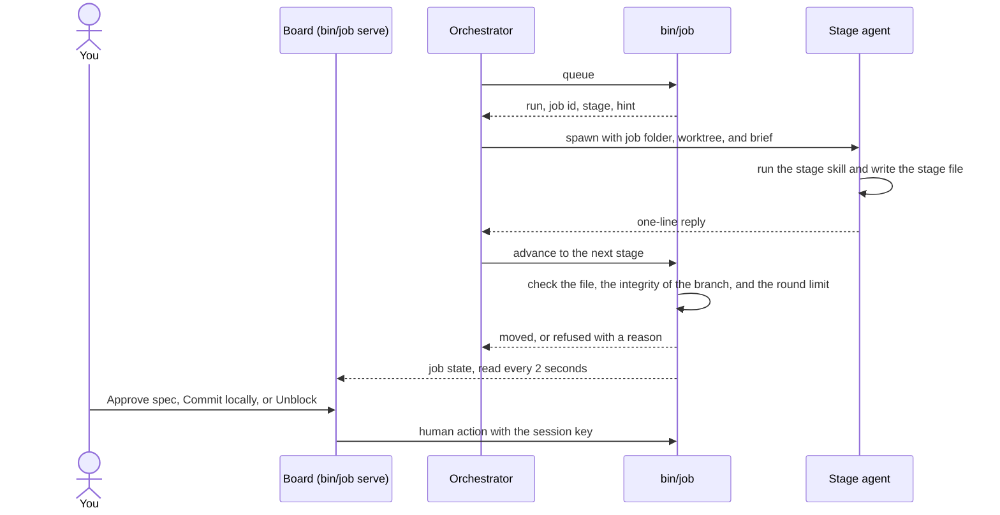
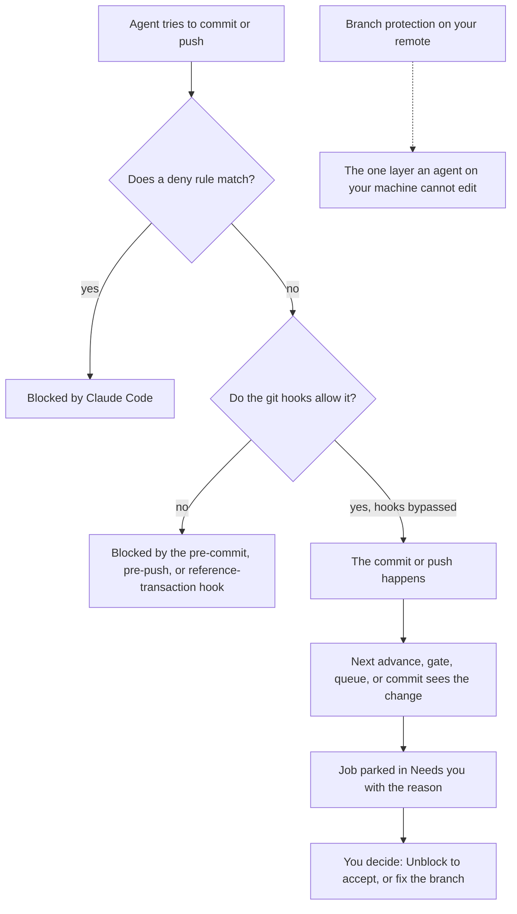

# Factory

The factory takes a feature from idea to a reviewed, committed change on a local branch. It does this by chaining the other skills in this repo as stages. A script moves each job from stage to stage and checks the evidence before every move. You follow the work on a kanban board.

It never pushes and never opens a PR or MR. The only commit is the one you make by clicking a button on the board.

To review an existing branch, use the separate `factory-review` skill. It has the same layout, its own engine and board, and never writes code.

`SKILL.md` is the contract an agent follows. This file explains how the pieces fit.

## Quick start

1. Link the factory and the skills it calls into `~/.claude/skills`: `factory`, `lets-talk-about-it`, `prd-mode`, `swe`, `code-review-frontend`, `qa-review`, `test-review`, `comment-sicko`, `prove-it-works`, `pr-body-style`, plus the stack skills you use.
2. In the project, create `.planning/factory/config.json` and set the command that must pass before review:

   ```json
   { "checks": "npm test" }
   ```

   Other keys: `concurrency` (default 1), `max_rounds` (default 3), `base_branch` (default `main`), and extra `protected_paths`.
3. Install the deny rules for your harness: `bin/tick install claude`.
4. Start a job in Claude Code with `/factory <feature idea>`.
5. Open the board in your own terminal with `bin/job serve`, then open the address it prints.
6. Keep passes going with `/loop 5m /factory run`, or schedule `bin/tick claude` with cron.

Gitignore `.planning/` and `.worktrees/` in the project.

## How a job moves

Every job is a card on the board. It sits in one stage at a time. The two stages marked **you** wait for a click on the board. Everything else needs evidence in a file.



Each stage runs the skill that owns it. A fresh subagent does the work and writes one file with a status line first. `bin/job advance` reads that line and refuses the move if the evidence is missing.

| Stage | Skill | File it writes | Next move needs |
| --- | --- | --- | --- |
| shape | `lets-talk-about-it` | `shape.md` | `STATUS: READY` |
| spec | `prd-mode` | `spec.md` | your approval on the board |
| build | `swe` plus stack skills | `build.md` | `STATUS: READY`, changes left uncommitted |
| gate | `bin/job gate` (a script) | `round-N/checks.md` | `GATE: PASS` |
| review | `code-review-frontend`, `qa-review`, `test-review`, plus `security-review` or `architecture-review` when the diff calls for them | `round-N/review-<name>.md`, then `reconcile.md` if anything is CHANGES | `VERDICT: PASS` from every reviewer |
| polish | `comment-sicko`, then `unslop` | `polish.md` | `STATUS: DONE`, then a fresh gate run |
| prove | `prove-it-works` | `uat.md` | `STATUS: PASS` |
| ship | `pr-body-style` | `pr-body.md` and `commit.md` | your Commit locally click |

A job gets `max_rounds` build rounds. After that it moves to **Needs you** instead of looping. Editing `spec.md` after you approve it blocks the build until you approve again.

## Stack skills

`bin/job` picks the skills for the codebase from file names. You do not choose them, and an agent does not judge them. The choice is stored in `job.json`, shown on the card, and printed in `bin/job queue`.

| Files in the repo (build) or the diff (review) | Skill |
| --- | --- |
| `.ts`, `.tsx`, `.js`, `.jsx` | `typescript-strict-style` |
| `.tsx`, `.jsx`, `next.config.*` | `vercel-react-best-practices` |
| `proxy.ts`, `middleware.ts` | `nextjs-proxy-csp-hardening` |
| `.cs`, `.csproj`, `.sln`, `.cshtml`, `.razor` | `dotnet` |
| `.tf`, `cdk.json`, `serverless.yml` | `aws` |

## One pass

A pass is one run of `/factory run` or `bin/tick`. The orchestrator asks the script what to do, spawns agents, and lets the script judge the results. A pass ends when nothing is left to run. Everything is in files, so the next pass resumes every job.



`bin/job queue` marks each job `run`, `hold` (waiting on you), `wait` (over the concurrency cap), or `done`. The orchestrator acts only on `run`.

## Following along

Two boards read the same files and look the same.

| | `bin/job serve` | `bin/job watch` |
| --- | --- | --- |
| Who starts it | you, in your terminal | you or an agent |
| Buttons | Approve spec, Commit locally, Unblock | none |
| Holds the approval key | yes, in memory | no |
| Link | one-time code, valid 5 minutes | stays valid until the process stops, works in several tabs |
| Default port | 8765 | 8766 |

Use `watch` to see what an agent is doing. Use `serve` when you need to approve or commit. The header of a watch board says it is read-only.

## Who can do what

| Action | Agent | You, on the board |
| --- | --- | --- |
| Create, advance, gate, route, progress | yes, through `bin/job` | no need |
| Edit code in the worktree | yes, uncommitted | |
| Approve the spec | no | yes |
| Commit | no | yes, one click |
| Unblock a parked job | no | yes |
| Push, open a PR or MR | no | your own step, outside the factory |

`approve`, `commit`, and `unblock` are not CLI commands. They run only inside `bin/job serve`.

The board starts only in an interactive terminal. It binds to localhost and prints a one-time code that is valid for 5 minutes. The code becomes a session cookie. Every action also needs a custom header and a loopback `Host`. The approval key lives only in the server's memory, and the git hooks check its hash.

The commit click refuses unless all of these hold:

- the gate passed this round, and the working tree is the one that passed
- the branch holds no commit the board did not make
- no protected path was touched
- the repo's own hooks pass

## Safety layers

The layers differ in strength. Only your remote's rules stop an agent that runs as you.



| Layer | What it does | Strength |
| --- | --- | --- |
| Deny rules from `bin/tick` | stop the agent running commit, push, merge, rebase, cherry-pick, revert, am, commit-tree, update-ref, symbolic-ref, config, fast-import, git global options (`-c`, `-C`), `gh`, `glab`, `curl`, `wget`, and `sh -c` | Measured on Claude Code: 24 of 24 attack spellings blocked, each succeeding in a no-policy control. A script that shells out is not covered |
| Integrity checks in `bin/job` | detect a moved branch tip, changed hooks, a commit on a remote ref, a detached HEAD, or `job.json` that disagrees with the audit log | Detects, does not prevent. Parks the job on you |
| Git hooks in each worktree | refuse commits and pushes without the board's key, and chain to the repo's own hooks | A speed bump. `git -c core.hooksPath=/dev/null` and `push --no-verify` get past them |
| Board key and session | keep approve, commit, and unblock out of the CLI | Stops an agent using the CLI. A process running as you could open its own terminal |
| Protected paths | fail the gate when the diff touches CI config, CODEOWNERS, `.env`, hook config, and similar | Hard, for jobs the factory runs |
| `bin/tick` | refuses a headless pass unless the deny rules are installed | Hard, for the runs it starts |
| Branch protection on your remote | the only layer outside the agent's reach | Turn it on for every repo the factory touches |

## Files

State lives in the project, never in this repo.

| Path | Holds |
| --- | --- |
| `.planning/factory/config.json` | `checks`, `concurrency`, `max_rounds`, `base_branch`, `protected_paths` |
| `.planning/factory/jobs/<id>/job.json` | the job's state, written only by `bin/job` |
| `.planning/factory/jobs/<id>/*.md` | the stage files from the table above |
| `.planning/factory/audit.log` | one JSON line per state change, with the actor (`agent`, `human`, or `tick`) |
| `.planning/factory/hooks/<id>/` | the per-worktree git hooks |
| `.worktrees/<id>/` | the job's branch, `factory/<id>`, checked out locally |

## Commands

| Command | Does |
| --- | --- |
| `bin/job create <id> "<title>"` | start a build job at shape |
| `bin/job create <id> "<title>" --review BASE HEAD` | start a review job at scope. Left over from before the split: `factory-review` has its own engine and no longer uses it |
| `bin/job stack <id>` | recompute the stack skills for a job |
| `bin/job queue` | list jobs as `action id stage hint` |
| `bin/job advance <id> <stage>` | move a job if the evidence allows it |
| `bin/job gate <id>` | run `checks` in the worktree and record the result and tree hash |
| `bin/job route <id> security,architecture` | add reviewers |
| `bin/job progress <id> <done> <total>` | set the task progress bar |
| `bin/job note <id> "<text>"` | record what the agent is doing now; the card shows the latest note |
| `bin/job serve [port]` | start the board with the approve, commit, and unblock buttons (needs your terminal, default port 8765) |
| `bin/job watch [port]` | start a read-only board to follow along (no terminal needed, no buttons, default port 8766) |
| `bin/tick <harness> [--dry-run]` | run one headless pass if the deny rules are installed |
| `bin/tick install`, `check`, `print`, `list` | install, verify, show, or list the deny rules |

## Harnesses

Claude Code is the supported harness. OpenCode and Kiro adapters exist and are untested. Codex support was removed.

Measure a harness before trusting it with `tests/probe_harness.py <harness>`. It runs each attack with and without the policy in a scratch repo and reports BLOCKED, GAP, or INCONCLUSIVE. A canary check refuses to attack until the harness is proven to be inside the scratch repo.

## Tests

```
python3 -m unittest discover -s factory/tests
```

123 tests, one skipped for a non-loopback bind. The run takes about two minutes. `test_job.py` covers the stages and the board, `test_integrity.py` replays the bypasses a red-team agent found, and `test_tick.py` covers the deny rules.

## Limits

- An agent that runs as your user can still edit files and run git. The factory makes that visible and stops the ordinary paths. Branch protection on the remote is the real guarantee.
- The gate is only as good as your `checks` command. Make sure it fails when no tests run.
- The stage skills run as full skills in real use. Testing so far used shortened versions to check the factory's contract.
