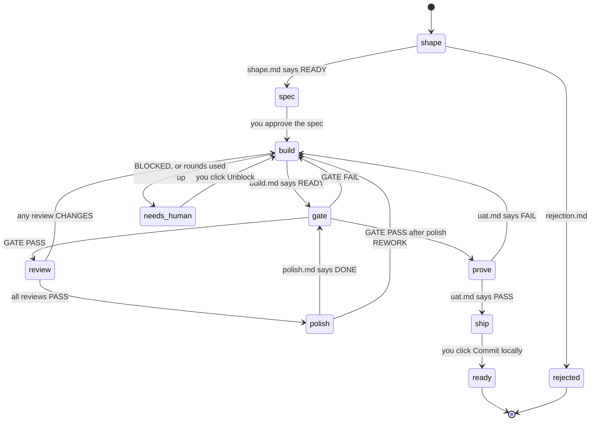

# Factory

The factory takes a feature from idea to a reviewed, committed change on a local branch. It does this by chaining the other skills in this repo as stages. A script moves each job from stage to stage and checks the evidence before every move. You follow the work, approve, and chat on a board of connected stages.

No stage agent pushes or opens a PR or MR, and the job's commit is the one you make by clicking a button on the board. You can tell the orchestrator in chat to commit or push, and it will.

It also reviews an existing branch or diff: a review job scopes the change, runs independent reviewers, reconciles and verifies their findings, and writes a report with paste-ready comments. A review never writes code and never posts unless you say so.

Every feature, command, safety layer and setting is explained in [docs/](docs/README.md). `SKILL.md` is the contract an agent follows.

## How a job moves

A job sits in one stage at a time. The stages marked **you** wait for a click on the board. Everything else needs evidence in a file.



## Quick start

1. Link the factory and the skills it calls into `~/.claude/skills`: `factory`, `lets-talk-about-it`, `prd-mode`, `swe`, `code-review-frontend`, `qa-review`, `test-review`, `comment-sicko`, `prove-it-works`, `pr-body-style`, plus the stack skills you use.
2. In the project, create `.planning/factory/config.json` and set your harness and the command that must pass before review:

   ```json
   { "harness": "claude", "checks": "npm test" }
   ```

3. Install the policy for your harness: `bin/tick install claude`.
4. Start a job in Claude Code with `/factory <feature idea>`.
5. Open the board with `bin/job board`, then open the address it prints.
6. Click **Approve spec** when the spec is right, and **Commit locally** when the job reaches ship.
7. Keep passes going after your clicks: run `bin/tick loop claude` in a spare terminal, or use `/loop 5m /factory run`.

Gitignore `.planning/` and `.worktrees/` in the project.

To review a branch instead: `bin/job create <id> "<title>" --review BASE HEAD`, then `/factory run`. To look into a question with no diff (an audit, "how good is X?"): `bin/job create <id> "<title>" --investigate`. In a new project, `/factory` sets itself up on the first run and Factory Bot can start the job from the board's chat.

## Who can do what

| Action | Agent | You, on the board |
| --- | --- | --- |
| Create, advance, gate, route, progress | yes, through `bin/job` | no need |
| Edit code in the worktree | yes, uncommitted | |
| Approve the spec | no | yes |
| Commit | no | yes, one click |
| Unblock a parked job | no | yes |
| Push, open a PR or MR | no | your own step, outside the factory |

## Where to read more

| You want | Read |
| --- | --- |
| The idea in plain words | [What is the factory](docs/what-is-factory.md) |
| Every feature, explained simply | [Features](docs/features.md) |
| A first job, step by step | [Tutorial](docs/tutorial-first-job.md) |
| One task done | [How-to guides](docs/how-to.md) |
| Every command and setting | [Commands and settings](docs/commands.md) |
| What stops an agent going wrong | [Safety](docs/safety.md) |
| Claude Code, OpenCode and Kiro | [Harnesses](docs/harnesses.md) |
| Changing the factory itself | [Developing](docs/developing.md) |
