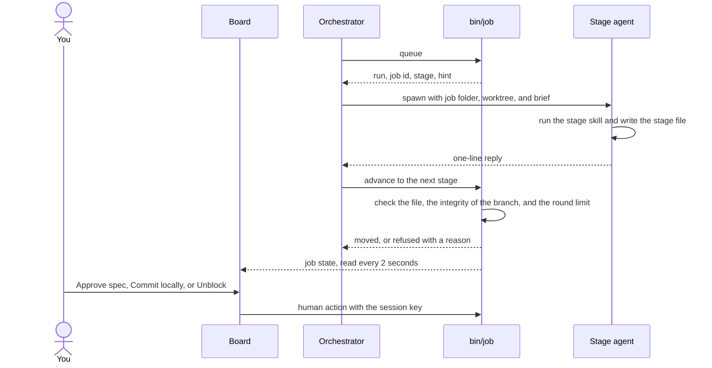

# Every feature, explained simply

This page explains every feature of the factory in plain words, as if to a very small person. Each feature has a one-line idea, then what it means for you. For exact commands, see [Commands and settings](commands.md).

## The whole thing in one picture

Think of a toy factory with a conveyor belt.

You drop an idea in at one end. The idea rides the belt past little robot workers. Each robot does one job, then a boring but honest inspector checks the work before the idea may ride on. At the very end, a shiny finished toy waits for you. Only you can say "yes, keep it".

| In the toy story | In the factory |
| --- | --- |
| The idea you drop in | A **job** |
| A spot on the belt | A **stage** |
| A robot worker | A **fresh agent** that does one stage and then forgets |
| The inspector | **`bin/job`**, a script that checks proof before every move |
| The big window where you watch | The **board** |
| Your say-so button | **Approve spec**, **Commit locally**, **Unblock** |
| The finished toy | A **commit on a local branch** |

## Part 1: The board (the window you watch through)

### 1.1 The board

A web page on your own computer. It shows every job as a little chip sitting on the stage it is in. Open it with `bin/job board`. You never need a terminal to use it.

### 1.2 The link with a secret code

The board prints a link that ends in `?c=` and a code. The code is a secret handshake. Open the link once and the board remembers you. The same link works in many browser tabs until the board is switched off. After the board remembers you, it sends you on to a plain address, so the code does not stay in the address bar.

When the board's own code changed after it started, `bin/job board` still prints the same link and adds a line saying to restart the board, and the page keeps saying "restart the board" until you do. It never restarts by itself, because that would log out every open tab.

### 1.3 Two boards: Build and Review

There are two boards on one page. **Build** shows jobs that make new things. **Review** shows jobs that only look at things. They never mix.

### 1.4 The left sidebar

A list of boards on the left. Click a board to open it. You can fold the sidebar away when you want more room, and drag the rows to put them in the order you like.

### 1.5 Tabs

Each open board is a tab, like in a browser. Drag a board from the sidebar onto the tab strip to open it. Drag tabs to reorder them. Close one with its x. Every tab keeps its own state, so switching tabs loses nothing. The page remembers your layout.

### 1.6 Stage nodes and chips

Each stage is a box called a **node**, joined by lines like a subway map. Each job is a **chip** sitting on its node. A node holding a job that is waiting for you gets an outline so you can spot it.

### 1.6.1 One lane per repo

When your project folder holds several repos (a GitLab group, say), give each job its repo: `bin/job create <id> "<title>" --repo <dir>`. The board then draws one **lane** per repo: the repo's name, then its own row of stages, with that repo's jobs on it. Each repo's agent moves along its own lane, so you see every repo's progress at once instead of one long line. A board with no `--repo` jobs looks as before. Each chip also shows the job's latest "now:" note under its title.

### 1.7 Filters

Buttons along the top that hide the noise:

- **Needs you** shows only jobs waiting for your click.
- **Ready to land** shows finished jobs waiting to be committed.
- **Pipeline** is about the stage order. A change waiting for your Apply click appears under **Pipeline change** (see [Part 9](#part-9-custom-stages-your-own-boxes-on-the-belt)).

### 1.8 The side panel

Click a chip and a panel opens. It shows the job's status, the right button for you to click, the skill switches, a note box for each stage, a list of every file the job has written, and the latest "now:" note from the agent.

### 1.9 Live updates

The board looks at the job files every 2 seconds, so you see changes without refreshing.

### 1.10 The progress bar and the "now:" note

While a build agent works, it can say how many tasks are done out of how many. That fills a little bar on the card. It can also post a short sentence about what it is doing right now. The card shows the latest one. It is the only live peek you get between stage changes.

## Part 2: A build job (making a new thing)

A build job rides nine places on the belt. A fresh agent does each stage, writes one file, and the script reads the first line of that file. No file, no move.

### 2.1 Shape: "what are we really making?"

An agent asks you good questions and works out what to build. It uses the `lets-talk-about-it` skill. If the plan depends on something nobody knows yet, it may try a quick throwaway experiment with the `spike` skill first. If the idea is a bad one, it writes `rejection.md` and the job stops as **rejected**. Otherwise it rewrites `shape.md` in plain words with `simplify`, with the decisions you need to approve at the top.

### 2.2 Spec: "write the plan"

An agent writes the plan (`spec.md`) and a list of small tasks, using `prd-mode`, then rewrites the plan and the task list in plain words with `simplify`. The decisions you need to approve come first. Then the belt **stops and waits for you**.

### 2.3 Approve spec (your button)

You read the plan. If it is good, click **Approve spec**. Nothing can be built before you click. Only you can do it.

### 2.4 The spec lock

After you approve, `spec.md` is locked. If anyone changes it later, the build stops until you approve the new version. This keeps the plan from quietly changing under you.

### 2.5 The worktree and the branch

When you approve, the factory makes a **worktree**: a private copy of your project in `.worktrees/<id>/`, on the ticket's branch, `feature/<TICKET>`. The ticket is the id's leading key and number, so job `proj-174` and job `proj-174-data-ui` both use `feature/PROJ-174`. A job made with `--repo` gets its worktree from that repo, so two repos can work on one ticket at once. The branch must already exist and must not be checked out in your own folder: the factory never creates a branch. A review job gets a detached copy with no branch. Agents play in the copy, so your own folder stays safe.

### 2.6 Build: "make it"

An agent writes the code, one small task at a time, using `swe` plus the stack skills (see [Part 4](#part-4-helpers-skills-and-reviewers)). It never commits. It leaves its changes lying on the table, uncommitted. If it gets stuck, it writes `STATUS: BLOCKED`.

### 2.7 Gate: "does the test command pass?"

A script, not an agent, runs the command you put in `checks`. If the command passes, the job moves on. If it fails, the job goes back to build. The gate also remembers a fingerprint of the files that passed, so later steps can prove nothing changed after. It never believes "I'm done". It believes only what the command printed.

### 2.8 Review: "do other eyes agree?"

Several reviewers look at the change, each on their own, without seeing each other's notes. Each writes `PASS` or `CHANGES`. If any says `CHANGES`, a helper merges the notes into one fix list (`reconcile.md`) and the job goes back to build. Every reviewer must say `PASS` to continue. See [Part 4](#part-4-helpers-skills-and-reviewers) for who they are.

### 2.9 Polish: "tidy up"

An agent removes pointless comments and workaround code with `comment-sicko`, and rewrites any prose it touched in plain words with `simplify`. If it finds a workaround that needs a real fix, the job goes back to build. After polish, the gate runs again.

### 2.10 Prove: "does it really work?"

An agent runs the real feature and checks the real result, with `prove-it-works`. It writes a user acceptance test document (`uat.md`) so you can check it yourself too. `PASS` moves on. `FAIL` sends the job back to build.

### 2.11 Ship: "write the paperwork"

An agent writes the pull request text (`pr-body.md`) and the commit message (`commit.md`) with `pr-body-style`. It may add a short spoken demo script with `demo-script`. Then the belt **stops and waits for you** again.

### 2.12 Commit locally (your button)

You read the paperwork and click **Commit locally**. The factory makes the one and only commit, on the job's branch. The click is refused unless all of these are true:

- the gate passed this round, on this exact set of files
- the branch has no commit the board did not make
- no protected path was touched (see [Part 7](#part-7-the-safety-guards))
- your project's own git hooks pass

### 2.13 Ready

The job is done. A local commit exists and a pull request text is written. No stage pushes. Pushing and opening the pull request is yours, done your own way, or by telling the orchestrator in chat.

A finished job leaves no worktree folder behind. Its branch stays until git says it is merged, then `bin/job prune` (or `bin/job close`) deletes it. A branch that is not merged, or that another live job still uses, is never deleted.

If you committed the work yourself instead of clicking **Commit locally**, run `bin/job close <id>`. It needs the job at ship, a passing gate, a clean worktree and a commit on the job branch. Then it moves the job to ready and removes the worktree.

### 2.14 Rounds

Each trip back to build is a **round**. A job gets three rounds by default (`max_rounds`). After that it stops looping and asks you for help. This keeps a stuck job from running forever.

### 2.15 Needs you and Unblock

When a job is blocked, out of rounds, or something looked tampered with, it moves to **Needs you** with the reason. Read the reason, fix what it names, and click **Unblock** (your button). The job tries its stage again.

## Part 3: A review job (looking at something that already exists)

A review job checks a branch or a diff. It writes **no code**. Create one with two local refs: `bin/job create <id> "<title>" --review BASE HEAD`. It runs once, with no rounds. The Review board shows it.

### 3.1 Scope: "what are we looking at?"

An agent finds the project's own lint, type and test tools, and builds a **Boundary map**: a list of every outside thing the change touches (database tables, other repos, shared libraries, queues), where the real definition can be read or that it cannot be reached, every "keep the output identical" promise, and every year or version written into the code. If it cannot continue, it writes `rejection.md` and the job stops as **rejected**.

### 3.2 Review: "find the problems"

Several reviewers look at the diff, each on their own. Every finding carries a tag so you know how sure it is:

| Tag | Meaning |
| --- | --- |
| `VERIFIED (read)` | the reviewer read the line and it says so |
| `VERIFIED (ran)` | the reviewer ran a command and it showed so. The command and output are written down |
| `[ASSUMPTION]` | the reviewer thinks so but did not check |

Each reviewer also fills in a **Blind spots** section, from the `review-blind-spots` skill. It forces a look beyond the diff: the real database, other repos, catch-all branches, dates pinned to a year, "keep it identical" promises, and "this is fine" claims traced to the real line. A review file with a blank in it is sent back once. Things the reviewer cannot reach become `UNCHECKED` findings, never a footnote.

### 3.3 Reconcile: "one list, please"

A helper (`reconcile-reviews`) merges every reviewer's notes into one ranked list, including every open question from the Boundary map.

### 3.4 Verify: "prove each finding"

A **different** agent, one that did not write the reviews, checks every finding. It opens the cited file and line, reruns every `VERIFIED (ran)` claim with its own command, and stamps each one:

| Stamp | Meaning |
| --- | --- |
| `CONFIRMED` | it is real |
| `DROPPED` | it does not reproduce, or it is wrong |
| `UNVERIFIABLE` | it cannot be run here, with the reason |
| `MISREAD` | a "this is fine" sentence that did not match the line it cites. It goes back on the list as a finding |

### 3.5 Report: "write it up"

An agent writes `report.md` (the counts, a short summary, a recommendation) and `comments.md` (one paste-ready comment per finding, each starting with `file:line`).

### 3.6 Read-only promise

Reviewers read and run code. They never edit, create, or delete anything in the worktree, which sits at the exact commit being reviewed. A reviewer who wants to try a changed version copies the files to a scratch folder and works there. If a tracked file changes, the branch moves, or the hooks change, the job stops and waits for you.

### 3.7 Never post unless you say so

No comment, review or approval is sent anywhere on the agent's own. If you tell it in the session to post `comments.md`, it posts each comment once through your forge's tool and writes `posted.md` listing what went out. Approvals and reviews are never posted. A scheduled pass never posts.

### 3.8 Blocked reviews

A reviewer that cannot go on writes `blocked.md` with `STATUS: BLOCKED`. The job waits for you, and **Unblock** resumes it.

### 3.9 Fixing what a review found

A review never fixes. To fix, start a separate build job.

## Part 4: Helpers (skills and reviewers)

### 4.1 Skills as stages

A **skill** is a packaged set of instructions. Each stage runs one skill. The factory is the glue that chains them: `lets-talk-about-it`, `prd-mode`, `swe`, the reviewers, `comment-sicko`, `simplify`, `prove-it-works`, `pr-body-style`, and more.

### 4.2 Stack skills picked by file names

`bin/job` looks at your file names and picks the right language helpers. Not an agent, so the choice is the same every time. The pick is saved in `job.json`, shown on the card, and printed in `bin/job queue`.

| If it sees | It adds |
| --- | --- |
| `.ts`, `.tsx`, `.js`, `.jsx` | `typescript-strict-style` |
| `.tsx`, `.jsx`, `next.config.*` | `vercel-react-best-practices` |
| `proxy.ts`, `middleware.ts` | `nextjs-proxy-csp-hardening` |
| `.cs`, `.csproj`, `.sln`, `.cshtml`, `.razor` | `dotnet` |
| `.py`, `.pyi`, `pyproject.toml`, `uv.lock` | `python` |
| `.tf`, `cdk.json`, `serverless.yml`, `samconfig.toml` | `aws` |

For a build job it looks at the files the job has changed so far (none at the start, so the hint says to pick by the files you touch), and the suggestion is refreshed when the build ends. For a review job it looks only at the files in the diff. Run `bin/job stack <id>` to look again after the build adds new files.

### 4.3 The skill switch

Do not want a helper on one job? Switch it off in the job's panel, or with `bin/job skill <id> <name> off`. Every later agent is told not to use it. Switch it back on any time.

### 4.4 Stage notes

Want to tell the next agent something? Type a note in the stage's note box (or `bin/job brief <id> <stage> "text"`). The next agent for that stage must follow it. Empty text clears it.

### 4.5 The reviewers

| Reviewer | Looks at |
| --- | --- |
| `code` | whether the code is right. Its skill follows the file types in the diff |
| `qa` | whether the change is easy to keep up: good building blocks, no giant files, no pile of tangled conditions |
| `test` | whether the change is tested well: regressions, edge cases, races, and a mutation check |
| `architecture` | the big shape: needless complexity, bottlenecks, risks, cost. Added only when a change crosses service or module boundaries |

The `code` reviewer's skill follows the files in the diff, and a frontend skill is never used on backend code:

| Files in the diff | `code` reviewer uses |
| --- | --- |
| `.ts`, `.tsx`, `.js`, `.jsx` | `code-review-frontend`, with `typescript-strict-style`, plus `vercel-react-best-practices` for React |
| `.py`, `.pyi`, `pyproject.toml` | `python` |
| `.cs`, `.csproj`, `.cshtml`, `.razor` | `dotnet` |
| `.tf`, `cdk.json`, `serverless.yml` | `aws` |
| any other language | the repo's own lint, type and test tools, plus `review-blind-spots` |

A mixed diff gets every row that matches, each applied only to its own files.

### 4.6 Adding a reviewer by hand

Run `bin/job route <id> architecture` to add the architecture reviewer to a job before the review stage.

### 4.7 A map of the codebase

If `.planning/` has no map of the project, the `whats-going-on` skill makes one before shaping or scoping, so agents are not working blind.

### 4.8 Smaller models for the checking stages

Where your tool lets you pick a model, review, polish, prove and ship agents run on a smaller one. Shape, spec and build keep the model of your session.

In Claude Code each stage's subagent gets `opus` (shape, spec, build), `sonnet` (review) or `haiku` (polish, prove, ship). In Kiro the model is picked per stage with `kiro-cli chat --model <id>`: `claude-opus-5.5` for shape, spec and build, `claude-sonnet-5.5` for review, `claude-haiku-5.5` for polish, prove and ship.

## Part 5: Running by itself

### 5.1 A pass

One **pass** is one run of the orchestrator. It asks the script what can run, starts one fresh agent per ready stage, checks their files, moves the jobs, then ends. All state is in files, so the next pass picks up exactly where the last stopped, in any tool.

### 5.2 The queue

`bin/job queue` prints one row per job with a word at the front:

| Word | Meaning |
| --- | --- |
| `run` | go, an agent can do this stage now |
| `hold` | stop, the job is waiting for you |
| `wait` | queue up, too many jobs are running |
| `done` | finished |

The orchestrator acts only on `run`.

### 5.3 Concurrency

`concurrency` (default 1) is how many jobs run at once. Extra jobs show `wait`. With one job per repo, set it to the number of repos so every repo's agent runs in the same pass.

### 5.4 Advance, and what a refusal means

`bin/job advance <id> <stage>` is the only way a job moves. It reads the stage's file and checks the first line. If the file is missing or the line is wrong, it refuses and says why. The orchestrator sends the stage back once with the problem named. After a second refusal, the builder writes `STATUS: BLOCKED`.

### 5.5 Waiting for you without giving up

When a job waits on your click, the orchestrator does not quit. It runs `bin/job wait`. That sleeps until you click, then prints `RESUME` and the work carries on. If time runs out it prints `STILL WAITING` and tries again.

### 5.6 The loop

A pass stops when nothing is left to run. Your next click needs a new pass. The **loop** starts one for you: `bin/tick loop claude` checks every 15 seconds and starts a pass whenever a job can run. It never approves anything. It runs one loop per project, and if a job makes no progress in two passes in a row it marks it `stalled` on the board and stops retrying. Alternatives: `/loop 5m /factory run` inside Claude Code, or a schedule (cron or launchd) running `bin/tick claude`.

### 5.7 Dry run and once

`bin/tick claude --dry-run` shows what a pass would do. `bin/tick loop claude --once` checks a single time.

### 5.8 Three tools, one factory

Claude Code, OpenCode and Kiro all work, with the same rules and the same guard. See [Harnesses](harnesses.md).

### 5.9 Starting the board by itself

Many `bin/job` commands start the board for you if it is not running and print its link. Set `auto_watch` to `false` in `config.json` to stop that, and run `bin/job watch` yourself. `bin/job serve` and `bin/job watch` run the board in the foreground, on ports 8765 and 8766 by default.

## Part 6: Editing and chatting on the board

### 6.1 Editor tabs

Click a file in a job's panel and it opens in an editor tab beside the board tabs. You get a numbered-line editor, the file drawn nicely, and a comments sidebar. The panel only lists files. It never draws them. Your unsaved text stays when you switch back to the board.

### 6.2 Safe saving

Saving replaces the whole file, and needs the file's current fingerprint. If the file changed since you opened it, the save is refused (409) so you cannot overwrite someone else's work. If you try to change a `STATUS:` or `VERDICT:` line, it is refused too (422), because those lines steer the stages.

### 6.3 Comments for the chat agent

The comments sidebar in the editor tab sends a comment to the chat agent, along with the file name, the line range and the quoted text.

### 6.4 Diagrams

A fenced `mermaid` block in a file draws as a diagram once `FACTORY_MERMAID` names a `mermaid.min.js` on your machine. Nothing is bundled. Each diagram is drawn inside a locked box with no cookie and no access to the board. Without the variable, the block stays plain code.

### 6.5 The chat bar (Factory Bot)

The bar at the bottom of the board talks to an assistant that knows only about the factory. Ask it how things work, what happened to a job, or why something is stuck. It reads the job's files before it answers.

It can do only a few things:

- switch a skill on or off for one job
- set or clear a stage note
- post a "now:" note
- prepare a change to the custom stages

It cannot approve, commit, unblock, move a stage, edit `job.json` or code, use the network, or change a built-in stage. When you ask for something it cannot do, it says so and points at the nearest thing it can do.

### 6.6 Chat mode and Act mode

In **Chat** mode, a stage change the bot prepares waits for you to click **Apply**. In **Act** mode, the board applies the change for you as soon as the bot finishes. The change is still made by the board, never by the bot.

### 6.7 Pick the engine, model and effort

Under the chat bar you choose which tool answers (Claude Code, OpenCode or Kiro), which model, and how hard it thinks (Low, Medium, High, Extra high, Max).

### 6.8 Chat memory

Every turn is saved in `.planning/factory-board/chat.jsonl` and restored when the page loads.

## Part 7: The safety guards

The factory assumes an agent will sometimes try something it should not. So there are several guards, each catching what the one before might miss. Strengths and limits are in [Safety](safety.md).

### 7.1 Proof, not promises

A job moves only when a file or a command's output proves it. "I'm done" is never proof.

### 7.2 Only the script writes the state

`bin/job` is the only thing that edits `job.json`. Agents ask it. They never write it.

### 7.3 Three buttons only you can press

**Approve spec**, **Commit locally** and **Unblock** are refused on the command line and cannot be run by the chat bar. They run only from the board, with a key held in the board's memory.

### 7.4 The board's door lock

The board listens only on your own computer. The link's code becomes a cookie. Every action also needs a special header and a local host name. The approval key never touches a file.

### 7.5 The shell rules (policy)

`policy.yaml` is a list of shell commands in three piles:

- **Deny**: never allowed, such as `git push`, `aws s3 rm` and `curl -X POST`
- **Ask**: needs a human, such as `git add`, `git commit`, `git merge` and `git rebase`
- **Allow**: safe to run alone, such as tests, linters and format checks

Deny beats ask, and ask beats allow. A command no rule names counts as blocked.

### 7.6 Installing the rules

Set `harness` in `config.json` first (`claude`, `opencode` or `kiro`). `bin/tick` takes the tool from there and never guesses from what is installed. `bin/tick install` turns the policy into the format your tool understands and writes it. It replaces only files it stamped itself and refuses to touch anything else in the way. `bin/tick check` says whether it is installed and up to date. `bin/tick print` shows what would be written. `bin/tick list` lists the policies. A scheduled pass **refuses to run** until the policy is installed.

### 7.6.1 One narrowed agent per stage (Kiro)

In Kiro every stage gets its own agent, custom stages too. Each one starts with only its stage's skill, cannot start other agents, and may write only where its stage works: shape and spec in `.planning/`, build and polish in the worktrees and job folders, everything else only its notes in the job folder. Its shell rules are exactly the orchestrator's. Each file is stamped, so `bin/tick check` notices when a pipeline change left it stale, and `bin/tick install` refreshes it. Claude Code and OpenCode keep one set of rules for the whole project for now.

### 7.7 The guard hook

Each tool has a "trust everything" mode that would skip the rules. The **guard** (`bin/guard`) is a hook that runs anyway. It checks every part of a shell command against the rules, blocks anything it cannot read, and checks that file writes do not land on protected paths.

### 7.8 Extra rules for building only

`policy.build.yaml` allows formatters that rewrite files (like `prettier --write`, `black`, `gofmt -w`, `cargo fmt`). Only build jobs load it. A review never loads it, because a review must not change the code it reads.

### 7.9 Your own allowed commands

Add patterns to `allow` in `config.json`, for example `make verify*`, so agents can run them alone. Your `checks` command is already allowed. Agents cannot edit `config.json`.

### 7.10 Protected paths

Some files are off limits: CI config, CODEOWNERS, `.env`, hook config, the factory's own config, and any paths you add in `protected_paths`. If a job's changes touch one, the gate fails.

### 7.11 Git hooks in each worktree

The factory installs no hooks of its own. You can commit and push in a job's worktree at any time, and your project's own hooks run as in any checkout. The stage agents are still told not to commit, push or merge: that rule is the agent policy, not a git hook.

### 7.12 The integrity checks

On every advance, gate, queue and commit, `bin/job` looks for signs of tampering: a detached HEAD, a worktree on the wrong branch, a reviewer editing a tracked file, or a `job.json` that disagrees with the log. Your own commits and pushes never park a job. If it finds one, it parks the job in **Needs you** with the reason. These checks catch trouble. They do not prevent it.

### 7.13 The audit log

Every state change is one line in `.planning/factory/audit.log`, with who did it: `agent`, `human` or `tick`. Read it to answer "what happened?".

### 7.14 Protect your remote too

Branch protection on your remote is the only guard an agent on your computer cannot edit. Turn it on for every repo the factory touches.

### 7.15 Measuring a tool

`tests/probe_harness.py <harness>` tries a list of attacks with and without the policy in a throwaway repo, and reports `BLOCKED`, `GAP` or `INCONCLUSIVE`. A canary check refuses to attack until the tool is proven to be inside the throwaway repo.

## Part 8: Settings you control

Everything lives in `.planning/factory/config.json`. Agents cannot change it.

| Setting | Plain meaning |
| --- | --- |
| `harness` | which tool runs the factory: `claude`, `opencode` or `kiro`. `bin/tick` refuses without it |
| `checks` | the command that must pass before review. The most important one |
| `concurrency` | how many jobs run at once |
| `max_rounds` | how many build tries before the job asks you for help |
| `protected_paths` | extra files agents must not touch |
| `allow` | extra commands agents may run alone |
| `auto_watch` | set to `false` so the board does not start itself |

## Part 9: Custom stages (your own boxes on the belt)

The built-in stages are fixed. You can add **custom stages**, extra boxes on the belt, to either board.

### 9.1 What a custom stage is

Data, not code. It has an id, a workflow (`build` or `review`), the stage it follows, a label, a short brief, and optionally one skill from this repo. It runs like any stage: the agent writes `<id>.md` with `STATUS: READY`, or `STATUS: BLOCKED` to park the job on you. A custom stage runs once per job and never waits on you itself.

### 9.2 Where one can go

After `shape`, `spec`, `build`, `review`, `polish` or `prove` on the Build board. After `scope`, `review`, `reconcile` or `verify` on the Review board. Or after another custom stage. Never after `gate`, `ship` or `report`, because those hold the safety checks and the commit click.

### 9.3 Ask, then click Apply

1. Tell the chat bar, for example "add a QA pass after review". It runs `job pipeline propose` to check everything. The board shows the waiting change under **Pipeline change**, with the new stage highlighted.
2. Click **Apply**, or **Discard**. Only then is `pipeline.json` written.

Apply is refused if a job sits in a stage the change removes, or if the pipeline changed since the proposal. In Act mode the board applies it for you.

### 9.4 Adding, removing, moving

`propose add`, `propose remove` and `propose move`. Moving a stage onto a spot that already holds a custom stage puts it in between, so nothing is lost. Removing a stage closes the gap. `job pipeline show` prints the order and where a stage can go. `job pipeline clear` drops the waiting change.

### 9.5 Honest limits

A stage that asks for a commit or a pull will stop with `STATUS: BLOCKED`, because the shell rules forbid them. The stage is still added. The bot says so in one sentence.

### 9.6 Shared by every project

`pipeline.json` sits beside `SKILL.md` and applies to every project. It is a plain file you can commit.

## Part 10: What the factory will never do

- Push, open a PR or MR, merge, or deploy
- Commit without your click
- Let an agent grade its own work
- Edit code in a review job
- Post a comment from a review unless you say so
- Use the network from an agent
- Move a job without proof

## Where to go next

- A first job, step by step: [Tutorial](tutorial-first-job.md)
- One task done: [How-to guides](how-to.md)
- Exact commands and settings: [Commands and settings](commands.md)
