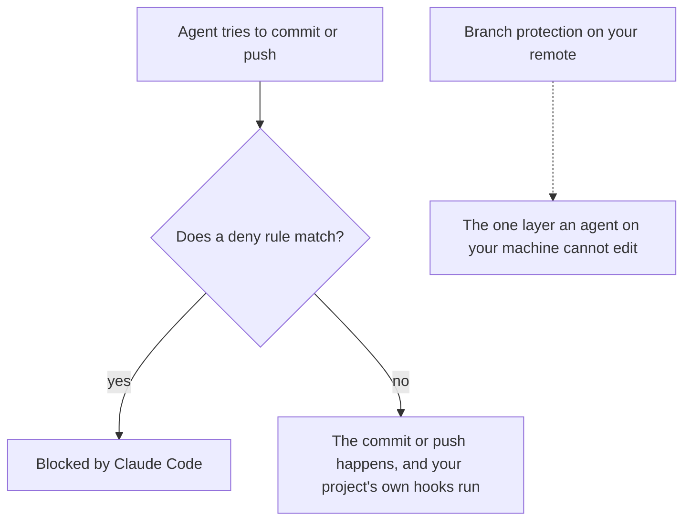

# Safety

What stops an agent from committing, pushing, or changing things it should not, and how strong each layer is. For the plain-words version of the same ideas, see [Features](features.md#part-7-the-safety-guards).

## Who can do what

| Action | Agent | You, on the board |
| --- | --- | --- |
| Create, advance, gate, route, progress | yes, through `bin/job` | no need |
| Edit code in the worktree | yes, uncommitted | |
| Approve the spec | no | yes |
| Commit | no | yes, one click |
| Unblock a parked job | no | yes |
| Push, open a PR or MR | no | your own step, outside the factory |

`approve`, `commit`, and `unblock` are not CLI commands. They run only from the board.

The board binds to localhost and prints a code in its link. The code becomes a session cookie. Every action also needs a custom header and a loopback `Host`. The approval key lives only in the server's memory, and the git hooks check its hash.

The commit click refuses unless all of these hold:

- the gate passed this round, and the working tree is the one that passed
- the branch holds no commit the board did not make
- no protected path was touched
- the repo's own hooks pass

## Layers

The layers differ in strength. Only your remote's rules stop an agent that runs as you.

| Layer | What it does | Strength |
| --- | --- | --- |
| Policy from `bin/tick` (`policy.yaml` plus a stricter deny list, and file-write limits) | stop the agent running commit, push, merge, rebase, cherry-pick, revert, am, commit-tree, update-ref, symbolic-ref, config, fast-import, git global options (`-c`, `-C`), `gh`, `glab`, `curl`, `wget`, and `sh -c`. Any command that skips git hooks (`--no-verify`, `commit -n`, `core.hooksPath`, `SKIP=`, `PRE_COMMIT_ALLOW_NO_CONFIG`) is denied, even when the rest is allowed | Measured on Claude Code: 24 of 24 attack spellings blocked, each succeeding in a no-policy control. A script that shells out is not covered |
| Integrity checks in `bin/job` | detect a detached HEAD, a worktree on the wrong branch, a reviewer editing a tracked file, or `job.json` that disagrees with the audit log | Detects, does not prevent. Parks the job on you. Your own commits and pushes never park a job |
| Board key and session | keep approve, commit, and unblock out of the CLI | Stops an agent using the CLI. A process running as you could open its own terminal |
| Protected paths | fail the gate when the diff touches CI config, CODEOWNERS, `.env`, hook config, and similar | Hard, for jobs the factory runs |
| `bin/tick` | refuses a headless pass unless the policy is installed | Hard, for the runs it starts |
| Branch protection on your remote | the only layer outside the agent's reach | Turn it on for every repo the factory touches |

## Notes on the allow list

The allow list is a set of command patterns. It cannot see what a command does inside. Read these before you rely on it.

- **Scripts that fix files.** A lint or format script in `package.json` that internally runs `--fix` is invisible to the policy, because the policy only sees `npm run lint`. For a build job this is allowed to change files, so nothing parks the job. The gate and the reviewers see the result.
- **`rubocop -A`.** `bundle exec rubocop*` is allowed as written, so builders can autocorrect with `-A` or the long flags.
- **`dotnet build` and `dotnet test`.** Both restore packages, so they can use the network. They are allowed because they do not work otherwise.

## Limits

- An agent that runs as your user can still edit files and run git. The factory makes that visible and stops the ordinary paths. Branch protection on the remote is the real guarantee.
- Running tests runs the project's code. The policy sees the test command, not what the tests do inside it. A review of a branch you do not trust is therefore code execution on your machine. The worktree hooks and the integrity checks catch a commit or an edit to tracked files, not a network call or a write outside the worktree.
- The ask rules are enforced by the harness, and no human is there to answer one in an unattended pass. That is the intent. Only Claude Code's handling is known from its documentation. Kiro refuses an `ask` in a headless run. Under `--trust-all-tools` the `kiro-guard` hook blocks it. OpenCode's handling is unmeasured.
- A command the allow list permits can still write a file through shell redirection (`echo x > file`). The file-write rules cover the harness's edit tools, not the shell. The integrity checks catch a commit, a moved branch, or changed hooks, and park the job. They detect, they do not prevent.
- The gate is only as good as your `checks` command. Make sure it fails when no tests run.
- The stage skills run as full skills in real use. Testing so far used shortened versions to check the factory's contract.
